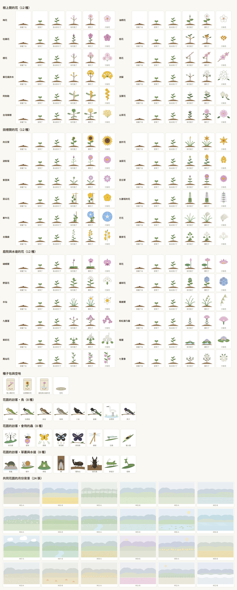

# 透析中的遊戲化之二：小花園的植物

版本：v0.1　文件狀態：草案（2026-10-10 開立）　適用讀者：院方（護理部、社工）、FDE 工程團隊

上層文件：《[透析中的遊戲化之一：決定、開關與實作順序](dialysis-gamification-decisions.md)》第 5.2 節

---

## 摘要

- 小花園植物的內容子文件（實作規格書 4.21 開工第一件事）：種哪些花、避開哪些花、成長階段、三種種子、24 張月份背景
- 不是需求文件；程式裡的數字以 `@hd/shared` 的 `garden.ts` 為準，這一份改了要同步改那裡
- 選花五條準則；避開有喪葬或不吉聯想的花（菊花、白百合、白海芋、劍蘭、白康乃馨、含笑、苦楝），也避開紅色
- 1015 擴充到 36 種（三種種子各 12 種），1017 迭代 24.1 畫好；種子袋、小訪客、圖鑑 1018 迭代 24.4 完成
- 第 5～6 節成長階段與開花之後，第 8 節共同花園的 24 張月份背景
- 第 10 節第一年之後每一季加什麼，第 11 節還沒決定、要長者看過的

## 0. 本文件的定位

遊戲化決定 5.2 規定：小花園的植物插畫由 AI 畫，**畫之前先寫一份分析子文件**，判斷要種哪些花、避開哪些花、每種花畫幾個成長階段、三種種子怎麼配、第一年之後每一季加什麼，以及共同花園的 24 張月份背景。這一份就是那份子文件，也是實作規格書 4.21（迭代 21）「開工第一件事」。

**這一份不是需求文件。** 需求在 SRS FR-P16、FR-P19、FR-S17 與實作規格書 4.21；這裡只決定內容。程式裡的數字（成長門檻、花的清單）以 `@hd/shared` 的 `garden.ts` 為準，這一份改了要同步改那裡。

**1015 擴充**（使用者決定，見《[之四：花園與相簿的擴充](dialysis-gamification-expansion.md)》）：花從 12 種加到 **36 種**（每種子 12 種，第 3、4 節）、種子袋每次療程補到 3 顆（第 5 節）、花園會來小訪客、圖鑑照種子分頁並列出還沒收到的空格。新的 24 種**1017 迭代 24.1 已畫好、寫進 `garden.ts`**（實作規格書 4.24）；種子袋、小訪客、圖鑑的新排法 **1018 迭代 24.4 完成**。

---

## 1. 選花的五條準則

| # | 準則 | 為什麼 |
|---|---|---|
| 1 | **台灣慣用名、長輩一看就認得** | 第一次種下去的花要是長輩最熟的（上層 5.2「發現」階段）；花名用台灣的叫法，不用學名或外來譯名 |
| 2 | **每一季都有當季的花** | 節令花讓「這個時候開這個花」對得上長輩的生活經驗（上層 4.9 好奇心、5.2「終局」） |
| 3 | **不用紅色** | 病人端紅色只給求助按鈕（《介面設計基準》4.1、H-5）。粉紅、紫、黃、白、藍都可以；正紅、朱紅、大紅的花不收 |
| 4 | **沒有喪葬、不吉、病、毒的聯想** | 花會被送進護理站（FR-P19），送出一朵會被誤會的花，比不送更糟 |
| 5 | **畫得出來、分得出來** | AI 直接畫的是向量圖（決定 5.2 末段）；每一種花要有一眼就分得出的輪廓（花瓣數、形狀、排法），不只靠顏色（《介面設計基準》P-4） |

---

## 2. 要避開的花

| 花 | 為什麼不收 | 備註 |
|---|---|---|
| 菊花（白菊、黃菊） | 告別式最常見的花 | 波斯菊是另一屬、在台灣是休耕田的花海，**收**（第 3 節） |
| 白色百合（含台灣百合） | 告別式常用；送進護理站容易被誤會 | 台灣百合是原生種、上層 7.5 舉過例，**起始先不收**，等院方看過再決定能不能只收進圖鑑、不能送 |
| 白色海芋 | 喪禮花藝常用 | 竹子湖海芋季很有名，可惜 |
| 劍蘭（唐菖蒲） | 告別式花藝常用 | |
| 白色康乃馨 | 悼念母親的花 | 粉紅康乃馨可以，起始不收，母親節那一季再看（第 10 節）。**1015 擴充時提前收粉紅的**，請社工一起看（之四第 9 節第 5 題） |
| 含笑花 | 「含笑九泉」的聯想 | 庭院很常見，可惜（1015 擴充時排除） |
| 苦楝 | 台語音近「可憐」，民間不種在家裡 | 淡紫色的花很美（1015 擴充時排除） |
| 柚子花、龍眼花 | 透析病人要限制的水果（《之三》第 3 節第 6 條） | 1015 擴充時排除 |
| 石蒜（彼岸花） | 名字與死亡的聯想；全株有毒 | |
| 曼陀羅、夾竹桃 | 有毒 | |
| 罌粟 | 毒品聯想 | |
| 曇花 | 「曇花一現」是短暫、消逝的意思 | 花本身很美，但對透析病人的寓意不好 |
| 鳳凰花、扶桑、聖誕紅、紅玫瑰、仙丹花、木棉花 | 紅色或朱紅（準則 3） | 若之後有黃色或粉色的品種、畫得出來，可以用那個顏色收 |
| 蘭花裡的白色蝴蝶蘭 | 告別式也用白色蝴蝶蘭 | 粉紫色的蝴蝶蘭是開幕、過年送禮的花，**收粉紫色** |

判斷「可能被誤會」的準則：**送進護理站時，護理師第一個聯想是不是好事**。拿不準的先不收，留到第 11 節請院方看。

---

## 3. 36 種花

三種種子各 12 種，四季都有。「一句說明」是病人在圖鑑與開花那一頁看到的字，寫法比照介面設計基準：平實、短、不用驚嘆號。

**1015 從 12 種加到 36 種**（使用者決定，《之四》第 6.1 節）：第 3.1 節是起始的 12 種（1010，已畫好、已在 `garden.ts`）；第 3.2 節是新加的 24 種，**1017 迭代 24.1 已畫圖並寫進 `garden.ts`**。合起來每個月至少有 6 種當季的花（11 月最少，6 種；6～9 月最多，各 10 種）。

### 3.1 起始的 12 種（1010）

| 代號 | 花名 | 種子 | 花色 | 應景月份 | 一句說明（病人看到的） | 輪廓 |
|---|---|---|---|---|---|---|
| `PLUM` | 梅花 | 樹上開的花 | 淡粉、白 | 12、1、2 月 | 冬天開的花，越冷越開 | 五片圓花瓣、細花蕊 |
| `TUNG` | 油桐花 | 樹上開的花 | 白，花心淡紫 | 4、5 月 | 四五月山上一片白，像下雪一樣 | 五片長圓花瓣、花心有細紋 |
| `AZALEA` | 杜鵑花 | 樹上開的花 | 粉紫 | 2、3、4 月 | 春天校園和公園裡最常見的花 | 五片寬花瓣、上面一片有斑點 |
| `OSMANTHUS` | 桂花 | 樹上開的花 | 金黃 | 9、10 月 | 中秋前後開，香味傳得很遠 | 枝上一簇簇四瓣小花、深綠葉 |
| `SUNFLOWER` | 向日葵 | 田裡開的花 | 黃，花心棕 | 6、7、8 月 | 花朵跟著太陽，夏天開得最好 | 一圈尖花瓣、大花心 |
| `DAYLILY` | 金針花 | 田裡開的花 | 金橘 | 8、9 月 | 八九月山上開成一片，也能煮湯 | 六片尖花瓣的星形 |
| `COSMOS` | 波斯菊 | 田裡開的花 | 粉紫 | 11、12、1 月 | 冬天休耕的田裡開成花海 | 八片寬花瓣、瓣尖有缺口 |
| `RAPE` | 油菜花 | 田裡開的花 | 黃 | 12、1、2 月 | 冬天田裡的黃花，開完當肥料 | 一串四瓣小花 |
| `PHALAENOPSIS` | 蝴蝶蘭 | 庭院與水邊的花 | 粉紫 | 1、2、3 月 | 台灣的蘭花，花朵像蝴蝶 | 三片萼、兩片大圓瓣、唇瓣 |
| `LOTUS` | 荷花 | 庭院與水邊的花 | 粉，瓣尖淡 | 6、7、8 月 | 夏天的池塘，花和葉子都很大 | 層層尖花瓣、旁邊一片圓荷葉 |
| `GINGER_LILY` | 野薑花 | 庭院與水邊的花 | 白 | 6～10 月 | 長在水邊的白花，聞起來很香 | 綠苞上幾朵像蝴蝶的白花 |
| `HYDRANGEA` | 繡球花 | 庭院與水邊的花 | 藍紫 | 4、5、6 月 | 一團一團的小花，梅雨季開 | 一顆球、由四瓣小花組成 |

### 3.2 1015 加的 24 種

其中 11 種是原本第 10 節排在 2027 年的花，提前上（桃花、山茶花、玉蘭花、水仙、報歲蘭、粉紅康乃馨、茉莉花、九層塔的花、牽牛花、睡蓮、九重葛）。花色寫「淡粉」的，畫的時候飽和度要低到驗收腳本的紅色判準以下（第 7 節）。

| 代號 | 花名 | 種子 | 花色 | 應景月份 | 一句說明（病人看到的） | 輪廓 |
|---|---|---|---|---|---|---|
| `CHERRY` | 櫻花 | 樹上開的花 | 淡粉 | 2、3 月 | 春天上山賞櫻，整片山坡都是淡粉色 | 五片圓瓣、瓣尖有小缺口，幾朵一簇 |
| `PEACH` | 桃花 | 樹上開的花 | 淡粉 | 2、3 月 | 過年前後開，淡粉色的花開滿枝頭 | 五片尖圓瓣、細長的花蕊，貼著枝條開 |
| `TRUMPET_TREE` | 黃花風鈴木 | 樹上開的花 | 金黃 | 3、4 月 | 三月開花時葉子掉光，整棵樹金黃色 | 喇叭形的黃花一簇簇、枝上沒有葉子 |
| `FRINGE_TREE` | 流蘇 | 樹上開的花 | 白 | 3、4 月 | 四月開滿細細的白花，人家叫它四月雪 | 四片細長如絲的花瓣，滿枝像覆了雪 |
| `GOLDEN_SHOWER` | 阿勃勒 | 樹上開的花 | 金黃 | 5、6、7 月 | 夏天一串串黃花垂下來，像下黃金雨 | 一長串往下垂的五瓣黃花 |
| `MICHELIA` | 玉蘭花 | 樹上開的花 | 白 | 5～9 月 | 路口買一串掛在車上，整台車都是香的 | 細長的白花瓣半開，像毛筆尖 |
| `GOLDENRAIN` | 台灣欒樹 | 樹上開的花 | 黃 | 9、10 月 | 秋天樹頂開黃花，路邊最常見的行道樹 | 樹頂一大簇細碎的小黃花、羽狀葉；**只畫花，不畫之後的粉紅色果實** |
| `CAMELLIA` | 山茶花 | 樹上開的花 | 淡粉 | 11、12、1 月 | 冬天開的花，一朵一朵圓圓的很整齊 | 重瓣、一層一層排得很整齊、深綠的亮葉 |
| `MILK_VETCH` | 紫雲英 | 田裡開的花 | 淡紫 | 2、3 月 | 春天田裡的小紫花，以前拿來當綠肥 | 一圈小花排成小傘的樣子 |
| `ZINNIA` | 百日草 | 田裡開的花 | 粉紫，花心黃 | 4、5、6 月 | 花開得很久，從春天開到夏天 | 一層層的圓瓣、黃色的花心 |
| `LUFFA` | 菜瓜花 | 田裡開的花 | 黃 | 5、6、7 月 | 棚架上的黃花，開完就結出菜瓜 | 五片皺皺的大黃瓣、旁邊有捲鬚 |
| `BASIL` | 九層塔的花 | 田裡開的花 | 淡紫 | 7～10 月 | 家家戶戶種的九層塔，開出一層層小紫花 | 一支花穗上一層一層的小花 |
| `MORNING_GLORY` | 牽牛花 | 田裡開的花 | 藍紫 | 9、10、11 月 | 爬在籬笆上，早上開、中午就合起來 | 喇叭形、花心一顆白色的星、心形葉 |
| `SILVERGRASS` | 芒花 | 田裡開的花 | 銀白 | 10、11 月 | 秋天山坡上一片銀白，風一吹就搖 | 細長的葉、頂端一束羽毛狀的花穗 |
| `SUNN_HEMP` | 太陽麻 | 田裡開的花 | 黃 | 11、12、1 月 | 冬天休耕田裡的一片黃，種來養地的 | 一支莖上一串像小蝴蝶的黃花 |
| `BUCKWHEAT` | 蕎麥花 | 田裡開的花 | 白 | 11、12 月 | 秋冬田裡開成一片白，一朵只有米粒大 | 一簇簇米粒大的小白花、心形葉；**莖畫綠色**（實物偏紅） |
| `NARCISSUS` | 水仙 | 庭院與水邊的花 | 白瓣黃心 | 1、2 月 | 過年擺在桌上，白花黃心，滿屋子香 | 六片白瓣、中間一個黃色小杯 |
| `BAOSUI_ORCHID` | 報歲蘭 | 庭院與水邊的花 | 淡黃綠 | 12、1、2 月 | 過年前後開花，所以叫報歲 | 細長的葉、一支花莖上幾朵小蘭花 |
| `BOUGAINVILLEA` | 九重葛 | 庭院與水邊的花 | 紫 | 3、4、5 月 | 爬滿圍牆的紫色花，一開就是一大片 | 三片像紙一樣的苞片圍著小白花 |
| `CARNATION` | 粉紅康乃馨 | 庭院與水邊的花 | 淡粉 | 4、5 月 | 母親節送的花，花瓣邊緣有細細的鋸齒 | 重瓣、瓣緣鋸齒、細長的莖 |
| `JASMINE` | 茉莉花 | 庭院與水邊的花 | 白 | 5～8 月 | 小小的白花很香，還有一首歌在唱它 | 重瓣的小白花、圓圓的綠葉 |
| `WATER_LILY` | 睡蓮 | 庭院與水邊的花 | 淡紫 | 6～9 月 | 浮在池塘水面，早上開、傍晚合起來 | 平貼水面的尖瓣、旁邊一片有缺口的圓葉（與荷花分得出來：荷花高出水面、葉子沒有缺口） |
| `BALSAM` | 鳳仙花 | 庭院與水邊的花 | 淡粉紫 | 7、8、9 月 | 小時候摘它的花瓣來染指甲 | 葉腋下垂的小花、花後一根細細的距 |
| `ORANGE_JASMINE` | 七里香 | 庭院與水邊的花 | 白 | 8、9、10 月 | 圍牆邊的矮樹叢，開小白花，香味飄很遠 | 五瓣小白花一簇、深綠的小葉 |

**長得像的要分得出來**（準則 5）：梅花、櫻花、桃花都是淡粉五瓣——梅花圓瓣、細花蕊；櫻花瓣尖有缺口、幾朵一簇有長花梗；桃花尖圓瓣、貼著枝條開。茉莉與七里香都是小白花——茉莉重瓣、七里香五瓣一簇。荷花與睡蓮見上表。

**分類留得下以後新增的花**：花以代號存，不以清單位置存；存檔只存花的代號，不存圖（決定 5.4 第 8 條的精神）。每一種花多一欄「加入的時間」，第 10 節每一季加的花照同一張表往下加。

---

## 4. 三種種子

| 種子 | 名稱（病人看到的） | 裡面的花 | 第一次種開什麼 |
|---|---|---|---|
| `TREE` | 樹上開的花 | 梅花、油桐花、杜鵑花、桂花；1015 加櫻花、桃花、黃花風鈴木、流蘇、阿勃勒、玉蘭花、台灣欒樹、山茶花 | **梅花** |
| `FIELD` | 田裡開的花 | 向日葵、金針花、波斯菊、油菜花；1015 加紫雲英、百日草、菜瓜花、九層塔的花、牽牛花、芒花、太陽麻、蕎麥花 | **向日葵** |
| `COURTYARD` | 庭院與水邊的花 | 蝴蝶蘭、荷花、野薑花、繡球花；1015 加水仙、報歲蘭、九重葛、粉紅康乃馨、茉莉花、睡蓮、鳳仙花、七里香 | **蝴蝶蘭** |

**種子開什麼花**（第 7 角：不確定性與好奇心）：

1. **這位病人第一次種**：照上表最右欄，開長輩最熟的那一種（上層 5.2「發現」）
2. 之後：同一種子裡的花依權重抽，**當季的花權重 3、還沒開過的花權重 2**（兩者相乘），其他 1。所以當季、沒看過的花最容易開出來，但每一種都有機會
3. 抽籤用的是這一棵植物自己的編號（平板產生），平板與伺服器算出來的一樣——斷線時種下去，連線後伺服器重算也是同一種花
4. 開花之前看不到是什麼花：種子、芽、苗、花苞都只畫植物，開花那一刻才知道名字

---

## 5. 成長階段

每種花畫**五個階段**：種子、芽、苗、花苞、開花。前三個階段三種種子共用一套圖（長輩分不出幼苗是什麼花，畫得一樣反而不會猜錯）；花苞與開花每種花各畫一張，花苞的顏色已經是那朵花的顏色。

| 階段 | 成長點數 | 圖 |
|---|---|---|
| 種子 | 0 | 一小堆土、一顆種子 |
| 芽 | 1～2 | 兩片子葉 |
| 苗 | 3～5 | 一根莖、四片葉 |
| 花苞 | 6～7 | 莖、葉、一個那朵花顏色的花苞 |
| 開花 | 8 | 那朵花 |

**成長點數怎麼來**（上層 7.5「照療程次數長大」；實作規格書 4.21「不會枯、不會倒退、不能加速」）：

| 來源 | 點數 | 說明 |
|---|---|---|
| 每來透析一次 | **+2** | 種下之後每多一次療程，每一棵都加 2。**看的是這位病人有幾次療程，不是有沒有點開花園**：三次沒點開，第四次點開時照樣長了三次的份 |
| 澆水 | +1 | 每次療程花園門口一份水，點一下就澆整座花園 |
| 養分 | 每一份 +1 | 透析前問卷、心情問卷、衛教做完各一份（每次療程每種最多一次，與答案無關）；遊戲的那一份等麻將連連看與記憶相簿（迭代 22、23）接上 |
| 照顧的上限 | **每棵每次療程最多 +2** | 澆水加養分再多，同一次療程一棵最多多長 2 點——這就是「不能加速」 |

**算起來**：種下那一次有澆水 → 當場就發芽（點下去馬上看得到變化）；每次都有澆水、做一樣任務的人，**第三次療程就開花**（上層 5.2「上手：第一朵花在三次療程內開」）；什麼都沒做的人第五次療程開，**照樣會開**。

**不會枯、不會倒退**：點數只會加不會減；缺席兩週、住院一個月，回來時跟離開時一樣，只是補上這段期間有來的療程（沒來就沒有）。沒有任何「好久沒來」「花渴了」的字。

**種子袋（1015 新增，1018 迭代 24.4 已實作）**：每次療程開始時袋子**補到 3 顆**（不是再加 3 顆），種一棵用掉一顆，三種種子共用；用完時種子區一句「這次的種子種完了，下次來會再有 3 顆」。目的是不讓 12 棵在同一次開花，也不讓種子越積越多。為什麼是「補到」、為什麼是 3，見《之四》第 3 節。

---

## 6. 開花之後

照遊戲化決定 3.6：

- 開好的花**一直留在那一格**，系統永遠不自動移走
- 可以送給護理站（FR-P19），或種進這一班的共同花園（FR-S17）；送出或種下之後那一格變回空地
- 第一次開出某一種花，收進「台灣花卉圖鑑」（1018 起畫面上叫「圖鑑」）；送走、種走之後圖鑑照樣有。**1015 起**（1018 迭代 24.4 已實作）圖鑑照種子分頁、照第 3 節的順序排，還沒開過的花留空格、不寫名字，另有一頁「花園的訪客」（《之四》第 4、5.2 節）
- 12 格都有植物時，種子區旁安靜一句「花園滿了，可以把開好的花送出去或種到大家的花園，再種新的」，不提醒

---

## 7. 畫風與怎麼畫

| 事情 | 決定 |
|---|---|
| 畫風 | 植物圖鑑的線稿上色：輪廓清楚、顏色柔和、不加表情、不畫成卡通（上層 7.5「不能讓長輩覺得是給小孩玩的」） |
| 怎麼畫 | 由 AI 寫成**程式產生的向量圖**：每一種花的花瓣形狀、片數、排法寫成幾個參數，程式算出路徑，存在 `@hd/shared` 的 `garden-art.ts`。比起一張一張手寫 SVG 檔，改一個參數就能整批調整，兩端（病人端花園、護理站的花瓶）用同一份 |
| 安全 | 只用 `path`、`circle`、`ellipse`、`rect` 四種圖形與填色、線色、線寬、透明度幾個屬性；**沒有腳本、事件屬性、外部參照、文字、`transform`**（決定 5.4 第 6 條）。畫的時候由程式逐一對照白名單產生，驗收腳本再檢查一次 |
| 顏色 | 只在 `garden-art.ts` 裡（植物一張色票、背景每個月一組）；驗收腳本檢查**沒有任何一個顏色落在紅色的色相**（色相 345°～15° 且飽和度高）。綠色的葉子、棕色的土是植物本身的顏色，不是介面的語意色 |
| 大小 | 花園一格至少 96×96px（決定 3.6）。圖本身是 100×100 的座標，縮放不失真 |
| 動畫 | 沒有。點下去之後畫面直接換成下一個樣子（《介面設計基準》4.4：病人端唯一會自己動的是跑馬燈） |

**畫得出來的程度**：向量圖做得到精緻的線稿上色，做不到照片級寫實。夠不夠用，照上層 12.2 由長者在病床上實際看過再判斷（第 11 節）。

**1017 迭代 24.1**：插畫拆成四支——畫具與色票 `garden-art-kit.ts`（全部插畫的顏色都在這一張色票）、起始 12 種與背景 `garden-art.ts`、新的 24 種花 `garden-art-flowers.ts`、24 種小訪客 `garden-art-visitors.ts`；畫法與安全規則照上表。

全部插畫的總覽（36 種花每種五個階段與只有花的樣子，一個種子排成兩欄；三個種子包、空地、24 種小訪客、24 張背景；由 `scripts/garden-art-sheet.mjs` 畫出來截圖，1017 迭代 24.1 重截）：

---

## 8. 共同花園的 24 張月份背景

照遊戲化決定 3.6：每個月一張、兩年一輪，同一個月份的兩張季節相同、畫面不同。**偶數年用 A、奇數年用 B**；歸檔的花園保留它那個月的背景。

畫法：遠山、近景、天空三層加一種點景，顏色**刻意淡**（明度高、飽和度低），退在植物後面；不畫人、不畫建築招牌、不用紅色。

| 月 | A（偶數年） | B（奇數年） |
|---|---|---|
| 1 | 冬日山稜與梅林，淡粉的花點 | 休耕田的油菜花海，遠山淡藍 |
| 2 | 早春竹林與晨霧 | 河堤與剛冒出的新草 |
| 3 | 山坡上的杜鵑叢，淡粉色塊 | 春雨後的梯田，水面映著天 |
| 4 | 油桐花開的山，綠中一點一點的白 | 茶園的梯田，一條一條的綠 |
| 5 | 溪谷裡落滿油桐花 | 剛插秧的水田 |
| 6 | 夏天的荷花池 | 海岸與淡藍的海 |
| 7 | 午後的積雲與綠色稻浪 | 山中的溪流與綠蔭 |
| 8 | 開滿金針花的山坡 | 傍晚淡紫色的天與遠山 |
| 9 | 中秋的淡月與桂樹 | 稻穗轉黃的田 |
| 10 | 秋天的芒草山坡，銀白的芒花 | 收割後的稻田與稻草堆 |
| 11 | 楓香轉黃的山林（不畫紅葉） | 休耕田的波斯菊花海 |
| 12 | 海邊的防風林與冬陽 | 山上的雲海 |

背景代號寫成 `M01-A`～`M12-B`，存在共同花園那一座的資料列上（`shared_gardens.background_code`），歸檔之後不跟著換。

---

## 9. 四個階段

| 階段 | 小花園怎麼顧到 |
|---|---|
| 發現 | 遊戲圖示在基本資訊區，護理師口頭介紹一句（決定第 2 節第 1 題）；第一次種的花是長輩最熟的（第 4 節） |
| 上手 | 種下那一次澆水就發芽；照常做任務的人第三次療程開花（第 5 節） |
| 養成 | 起始 12 種、四季都有當季的花；種子開什麼花不一定，當季的、沒看過的比較常出現（第 4 節）。**1015 加到 36 種**，種子袋讓每次療程都有一點東西開（最積極的人約 12 週收齊，《之四》第 3.4 節） |
| **終局** | **圖鑑永遠收不完**：每一季加新花與節令花（第 10 節）；共同花園每個月換背景、兩年一輪；1015 起另有 24 種小訪客，每次點開花園約一半的機會來一隻，要將近一年才看得齊（《之四》第 4 節） |

---

## 10. 第一年之後每一季加什麼

上層第 5 節說終局做不好，半年後就沒人玩了。~~起始的 12 種大約要一年才收得齊~~ **1015 更正**：這個估計錯了。照《之四》第 3.4 節的模擬，不限種的時候 12 種最快兩週就收齊；**1015 起加到 36 種、種子袋每次補到 3 顆，最積極的人約 12 週收齊**，跟一季差不多。所以**開開關之後每一季加三種**（每種子一種），每一次都過第 1、2 節的準則，畫好之後經院方看過再上。

原本排在 2027 年四季的 12 種，1015 提前上了 11 種（第 3.2 節），只剩炮仗花。新的一輪：

| 季 | 加什麼 | 為什麼這幾種 |
|---|---|---|
| 開開關後第 1 季（春節） | 羊蹄甲（樹上，粉紫）、紫花酢漿草（田裡，粉紫）、炮仗花（庭院，畫偏黃的橘） | 春天校園與路邊常見；酢漿草是田埂上的小花；炮仗花年節前後爬滿圍牆，實物是橘紅，**顏色過不了第 1 節準則 3 就換一種** |
| 第 2 季（端午、夏天） | 大花紫薇（樹上，紫）、野牡丹（田裡，粉紫）、木槿（庭院，淡紫） | 夏天的行道樹、山邊的野花、圍籬的花 |
| 第 3 季（中秋） | 黃槿（樹上，黃）、大花咸豐草（田裡，白）、布袋蓮（水邊，淡紫） | 黃槿的葉子以前拿來墊粿；咸豐草是路邊最常見的小白花；布袋蓮開滿水溝與池塘 |
| 第 4 季（冬至、年底） | 美人樹（樹上，淡粉）、蘿蔔花（田裡，白帶淡紫）、繁星花（庭院，粉） | 秋冬的行道樹；冬天菜園裡的花；盆栽裡一年四季都開 |
| 之後每一季 | 由院方或病友回饋提名，照同一套準則挑 | 加一欄「誰提名的」不記名，只記「病友提名」「護理部提名」 |

小訪客另外每季加兩種（《之四》第 9 節第 3 題）。

**節令的驚喜**：當季的花在種子抽籤時權重本來就高（第 4 節）；新的一季加進來的花，第一季也算當季。

---

## 11. 還沒決定、要長者看過的

| # | 事情 | 怎麼決定 |
|---|---|---|
| 1 | 畫出來的花夠不夠像、會不會像給小孩玩的 | 上層 12.2：請長者在病床上實際看圖鑑與花園，問「這是什麼花」「像不像給小孩玩的」 |
| 2 | 台灣百合能不能收（第 2 節） | 請護理部看一次：只收進圖鑑、不能送，或乾脆不收 |
| 3 | 背景會不會太搶 | 共同花園種了幾朵之後實際看；太搶就把背景的明度再拉高 |
| 4 | 一句說明的用字 | 請護理部看過；改字只改 `garden.ts` 那一張表 |
| 5 | 1015 新加的 24 種花合不合適（含提前上的粉紅康乃馨） | 與第 1、4 題同一批看；細節見《之四》第 9 節 |

---

## 版本歷程

| 定版 | 日期 | 異動 |
|---|---|---|
| 1021 | 2026-10-21 | 1015 擴充到 36 種花（三種種子各 12 種），1017 迭代 24.1 畫好；種子袋、小訪客、圖鑑的新排法 1018 迭代 24.4 完成 |
| [1014](https://94sh09sh19sh.github.io/hd-docs/1014/notes/dialysis-gamification-garden/) | 2026-10-14 | 首次定版。迭代 21 開工前：12 種台灣常見的花與要避開的花、怎麼長大、24 張月份背景、之後每一季加什麼；附插畫總覽圖 |

[← 回上層文件](dialysis-gamification-decisions.md)　[← 回進度首頁](../index.md)
