# 1021 週報 — 花園與相簿的擴充、緊急通報的床邊前速覽完成（迭代 24、25），儀表板更新、固定橫放排成迭代 26～27

**期間**：2026-10-14 ～ 2026-10-21
**對應 commit**：`37c02bb` → 進行中（程式到迭代 25：`bcc1552`；定版前會再補）
**狀態**：進行中（2026-10-18 週中草稿，1021 定版時收尾）

---

## 本週進度

- **1015 使用者看過遊戲化的現況，做了六個決定**，寫成子文件《[透析中的遊戲化之四：花園與相簿的擴充](../notes/dialysis-gamification-expansion.md)》：相簿要有圖鑑、種花每次療程有上限而且種子不能越積越多、花園會來小訪客、花 36 種、相簿 120 張、兩個圖鑑照分類排；排成迭代 24
- **1015 緊急通報重新設計**：《[緊急通報的處理流程與護理紀錄連動](../notes/emergency-handling-redesign.md)》——專業版頂端求助橫幅結案後冒回來的缺陷、簡易版接通報前先開「床邊前速覽」、結案時建立護理紀錄草稿；使用者同日答了七題，排成迭代 25
- **1017 管理儀表板、獎勵制度與對外揭露的更新與修正**：對照迭代 20～25 補齊儀表板漏掉的資料、獎勵制度改成接手緊急通報時指名處理者；七題答覆寫進 SRS（81 → 83 條），排成迭代 26。**1014 定的病人平板固定橫放**（外殼鎖橫向、拿掉直放排法、麻將放寬）同日排成迭代 27
- **1017～1018 迭代 24 完成（遊戲化之五）**：花 12 → 36 種、24 種花園的小訪客、相簿 60 → 120 張（十二個主題）；**種子每次療程補到 3 顆**、小訪客約一半的療程來一隻（沒點不離開、點了不給任何東西）、**兩個圖鑑照分類排、列出空格**、相簿多一本「我的相簿」。兩個開關照舊預設關閉
- **1018 迭代 25 完成（緊急通報）**：專業版頂端的求助橫幅**結案或取消之後不再冒回來**；簡易版點紅框改成先開「**床邊前速覽**」（院方的數值與兩張折線圖、透析前問卷、本次與前 3 次療程的求助、待追蹤，不上色、不判讀），**看完按「我接手」才算接手**；身體不舒服的求助**結案那一下同時建好「求助處置」護理紀錄草稿**，事件時間是病人按下求助的時間
- 「我要找…」八份對到迭代 25（1018）：兩份進度報告、資料字典（92 張表 901 欄）、測試手冊（新增迭代 24 分冊 `ah1`～`ah34`、迭代 25 分冊 `ai1`～`ai34`，三十七本，路由 214 條）；架構圖兩張圖都不必改（只寫明理由）；部署手冊總覽補 24、25 的兩個遷移與探測工具多印的欄位；「這套系統是用什麼蓋的」只在 24 改了圖卡的張數、25 不必改（沒有新的工具或元件）；外殼契約不必改——兩個迭代都沒有新的元件與外殼介面

## 完成內容

### 迭代 24：花園與相簿的擴充（1017～1018）

畫圖的量大，照迭代 23 的做法切成四次子迭代。手動測試在《[迭代 24 分冊](../testing/iteration-24.md)》，做法與開發端的判斷在實作規格書 4.24。

| 子迭代 | 做了什麼 |
|---|---|
| 24.1（1017） | 花 12 → 36 種（每種子 12 種，起始 12 種原樣在最前面），24 種小訪客的清單與插畫；新花名的「欒」「蕎」補進字型；總覽圖重截（《[之二](../notes/dialysis-gamification-garden.md)》第 7 節） |
| 24.2（1017） | 相簿第三批 30 張：學校、街上與市場、田裡與海邊；開關的門檻只看起始的六個主題 |
| 24.3（1017） | 相簿第四批 30 張：聽的看的、穿的戴的、洗澡與打扮；120 張八週不重複 |
| 24.4（1018） | 種子袋、小訪客、花園圖鑑照分類排、相簿圖鑑「我的相簿」 |

| 事項 | 現在的樣子 |
|---|---|
| 種子袋 | 每次療程開始時**補到 3 顆**（不是再加 3 顆），三種種子共用；用完時門口一句「這次的種子種完了，下次來會再有 3 顆」，空地點不開。**畫面上沒有「上限」「不能種」** |
| 小訪客 | 點開花園時約一半的療程有一隻停在門口最下面一格，**連續兩次沒來第三次一定來**；只來這個月有出現的，當季的、沒看過的比較常來。**沒點就一直等著、不會飛走、一次最多一隻**；點開是牠的名字與一句說明，**不給水、養分或任何東西**。斷線時照樣會來 |
| 花園圖鑑 | 頂列那一顆改叫「圖鑑」：目錄四顆（三種種子、花園的訪客），每顆寫「收到幾種，共幾種」；花一類一頁 4×3、訪客一群一頁 4×2，**照固定順序排，沒收到的是空格、不寫名字** |
| 我的相簿 | 相簿封面多一顆；一頁 4 個主題、一個主題一頁 5×2。收的是翻開過答案的每一張，**點過「想起某個人」的照樣收、看不出差別**；只跳過的、下架的不在；點開是大圖、名稱、說明與點過的貼紙，**不寫選了什麼、不寫對錯** |
| 資料 | 一張新表（第一次看到哪一種小訪客）、操作紀錄多一欄；花園的存檔升到第 2 版，舊的存檔讀得出來、原樣保留。相簿圖鑑從作答算，不另存 |
| 驗收 | 新的兩支腳本（不需要後端一支、後端一支）全部通過，迭代 20～24.3 回歸通過；三支既有腳本隨需求調整（實作規格書之一第十八次） |

畫面見[附錄](#附錄截圖)。

### 迭代 25：緊急通報——頂端橫幅、床邊前速覽、護理紀錄連動（1018）

1015 使用者操作護理端之後提出的四件事（《[緊急通報的處理流程與護理紀錄連動](../notes/emergency-handling-redesign.md)》），三次子迭代同一天做完。手動測試在《[迭代 25 分冊](../testing/iteration-25.md)》，做法、開發端判斷五條與驗收現況在實作規格書 4.25。

| 事項 | 現在的樣子 |
|---|---|
| 頂端求助橫幅（25.1） | 接手後藏起來（照舊）；**結案或取消之後不再冒回來**。開發機上先把護理端換回舊版重現了一次：結案之後橫幅冒回來、取消之後也留著，對上規畫文件的原因；換回新版不再出現。斷線期間的求助接回來照樣出現 |
| 床邊前速覽（25.2） | 簡易版點紅框或還沒人接的求助：蓋在中間的平板區上，**上面的紅框列與右邊兩框不蓋、不捲動**；Esc、點外面、×、按完「我接手」都會關。左邊院方最新一筆的血壓脈搏、體溫、體重與理想體重（「多 2.4 kg」）、設定脫水量與它的組成、流速、透析液、Heparin、透析器、血管通路、透析前問卷；右邊兩張本次透析的折線圖（求助時間一條直的虛線）、本次與前 3 次療程的求助、待追蹤。**不上色、不分高中低、沒有預測機率與 AI 摘要，讀到 0 的不出現** |
| 看是看、接是接 | 只開來看，求助仍是待處理、紅框照閃；**速覽裡按「我接手」那一刻才是確認時間**。已接手的格子多一個小圖示可以重開速覽；專業版緊急通報頁每一筆多「病人簡介」，開同一份 |
| 院方多讀的欄位 | 每一筆的血流速、透析液流速、靜脈壓、透析液溫度，每次透析的體溫、輸液、食物、透析器、Ca、傳導度、血管通路、Heparin。**只收有配平板的病人、只給護理站看，不上病人平板**；讀不懂的當沒有值、不擋這位病人的其他資料 |
| 求助處置紀錄（25.3） | 身體不舒服的求助結案時，與結案同一筆寫進去：D 段是病人按下的那幾個字與附註、透析前問卷有症狀的題目、**按下前**最近一筆量測；A 段是按下、接手的時間與依序的處理方式；R 段是處理結果與**按下之後**的量測；SOAP 的 A（評估）留空；沒登記到達床邊就不寫到達。口渴、上廁所與病人自行取消的不自動建 |
| 之後怎麼改 | 結果在 60 分鐘內補改，還沒簽核的草稿跟著改，**簽核後一個字都不動**；護理紀錄頁卡片標「來自 HH:MM 的求助」（點了看那一則的速覽）、「依求助建立」列出已結案但沒有記錄的、草稿可以改套「透析中低血壓處置」這類範本（事件時間不變）；手動新增事件記錄的時間欄寫「請改成發生的時間」 |
| 驗收 | 新的兩支腳本（不需要後端一支、模擬院方 API＋後端一支）全部通過；迭代 14～24 的腳本與 15、16、17.8、14、14.1、19 的後端腳本回歸通過 |

畫面見[附錄](#附錄截圖)。

## 遇到的問題與處理

| # | 問題 | 處理方式 | 狀態 |
|---|---|---|---|
| 1 | 花園門口多了訪客那一格，原本一欄的澆水與養分疊不下，1280×800 會擠出來 | 門口改成 240px 兩欄（每顆 80px、圖示在上字在下）、那幾句用 20px；量過最壞的情形（水＋四份養分＋兩句＋訪客）剛好不捲動 | 已解 |
| 2 | 小訪客要「平板與伺服器算出同一隻」，但新花園原本第一步之後才寫存檔，編號每次讀都不一樣 | 第一次點開花園就寫下空花園，編號從此固定；舊的第 1 版存檔，編號由舊內容算出來 | 已解 |
| 3 | 相簿圖鑑要列出最後一次點的貼紙，平板的存檔沒有（只記「想起某個人」點過沒有） | 照子文件預留的做法向伺服器要，斷線時寫「連上網路之後再翻」 | 已解 |
| 4 | 速覽一蓋上去，簡易版的平板區被擠到右邊、右邊兩框掉到下面一列（第一次截圖看到的） | 速覽那一層與平板區佔同一格，自動排版把平板區往後推；平板區與右邊兩框改成寫明自己的格子 | 已解 |
| 5 | 頂端橫幅的修剪，如果快照的時間只要晚於求助送到就算數，後端寫進資料庫到快取更新之間那幾毫秒發出的快照，會把剛送到的緊急求助誤拿掉 | 送到後 5 秒內的狀態不拿來修剪；那 5 秒內就取消的那一則，最晚等下一次輪詢（15 秒）拿掉 | 已解 |
| 6 | 規格要 25.1 動手前先在開發機重現，開發端先做了修正 | 事後把護理端換回舊版重現一次，結果寫進規畫文件第 2.3 節與實作規格書 4.25，對得上原本的推論 | 已解 |

## 待決事項

**要問社工、護理部與長者：花園與相簿的擴充**（迭代 24 做完；**開兩個開關之前**要答覆，與迭代 21、23 的一起看，清冊 Q-31 第 9 題）：

- [ ] 新的 24 種花、24 種小訪客、60 張圖卡合不合適（《之四》第 9 節第 1 題）；粉紅康乃馨會不會讓母親已過世的人難過（第 5 題）
- [ ] 貓、狗要不要收進小訪客（第 2 題，請社工看）
- [ ] 長者在病床上看新的圖：認不認得、像不像給小孩玩的（迭代 24 分冊 §24.6）

**請護理站試用床邊前速覽**（迭代 25 做完）：

- [ ] 護理師實際用一次「開速覽、按我接手、回來點處理方式」：速覽上的東西夠不夠、多不多，離開護理站前看得完嗎（迭代 25 分冊 §25.2、§25.3）
- [ ] 結案時建好的求助處置草稿，D／A／R／T 的寫法貼進院內的正式紀錄合不合用（§25.4）

上週的待決事項（四條規則的門檻、Q-02、遊戲化的預設文字與插畫、獎勵制度與對外報表）見《[1014 週報](2026-10-14.md#待決事項)》，本週沒有新的答覆。

## 下週規劃

- ~~迭代 25（緊急通報：頂端橫幅、床邊前速覽、護理紀錄連動）~~ **1018 完成**
- 迭代 26（儀表板的資料補齊、圖與報表、處理者指名）：25.2 的速覽與 25.3 的求助處置紀錄都有了，三次子迭代都可以開工
- 迭代 27（病人平板固定橫放），最好排在第三次進院帶去的 tag 之前
- 第三次進院（實作規格書 4.19）照 1007 週報的規劃

---

## 附錄：截圖

開發機、合成資料。病人端 1280×800：

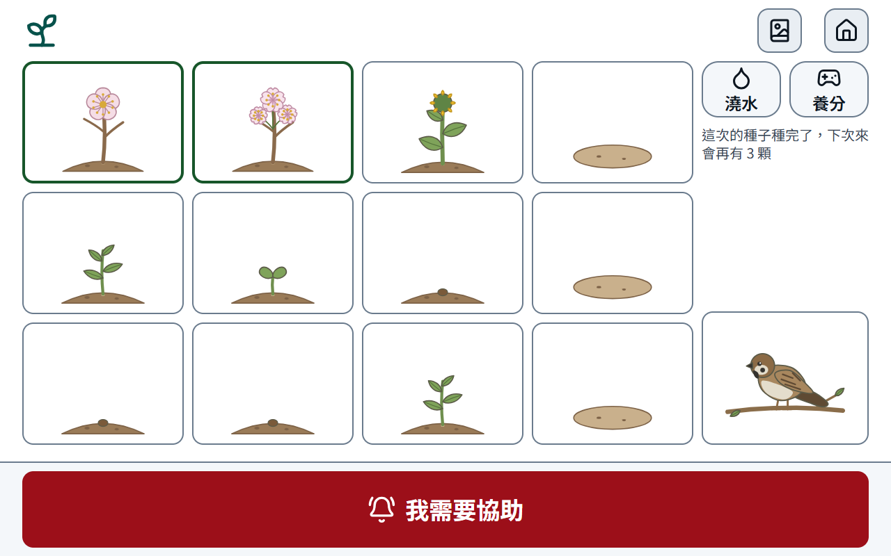

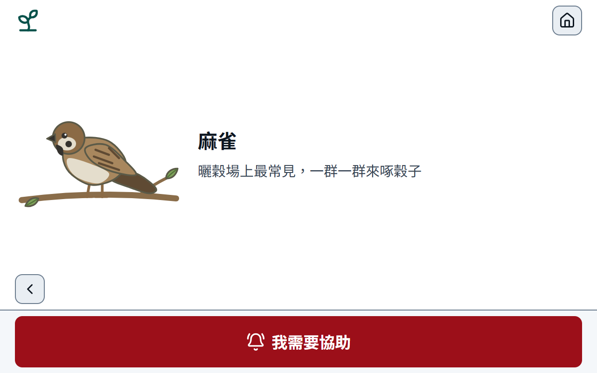

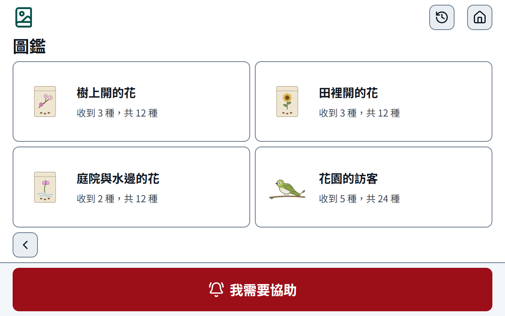

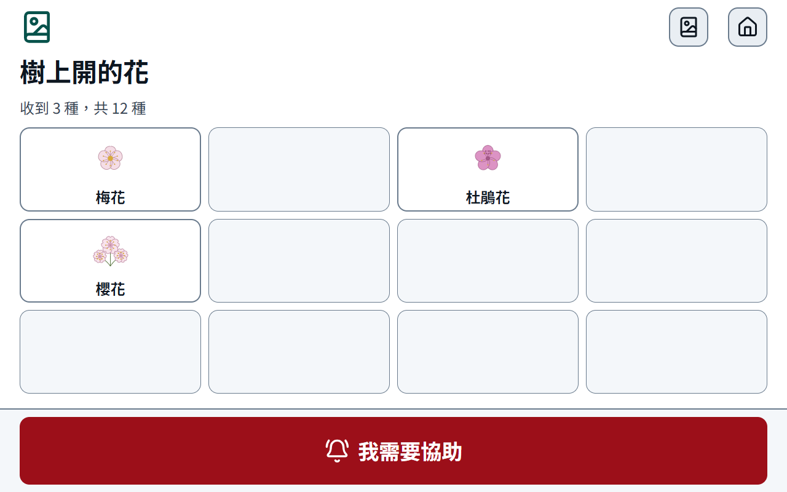

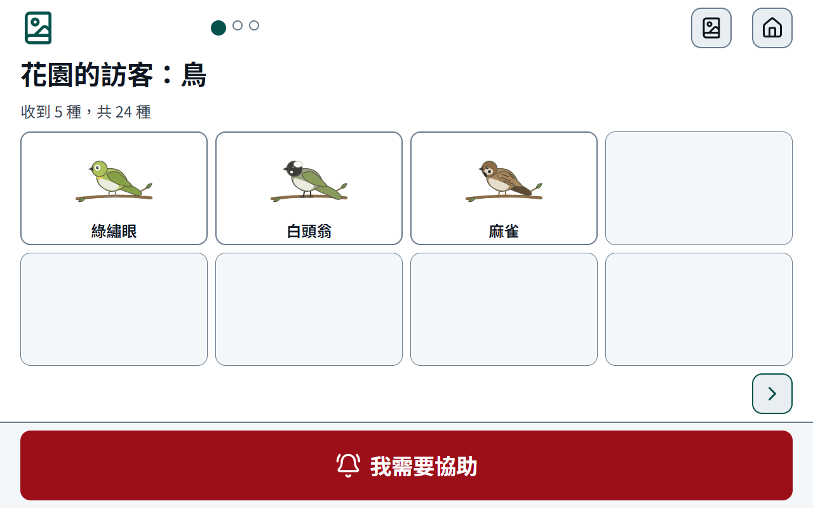

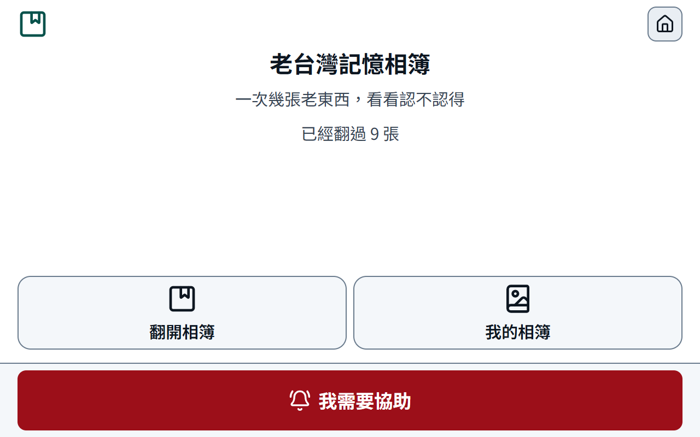

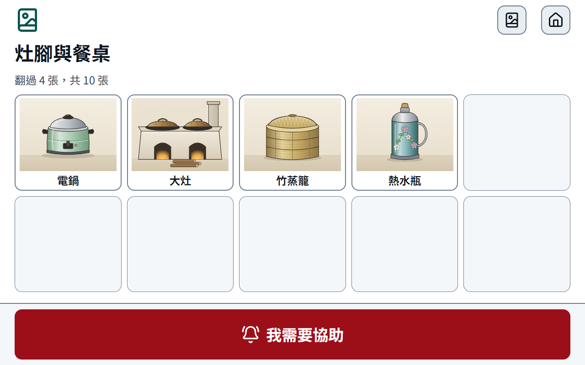

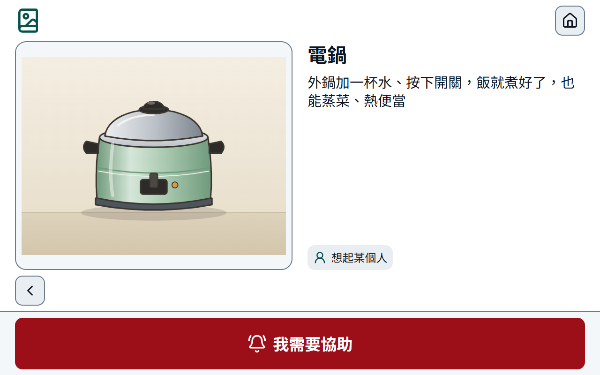

護理端 1366×768（迭代 25）：

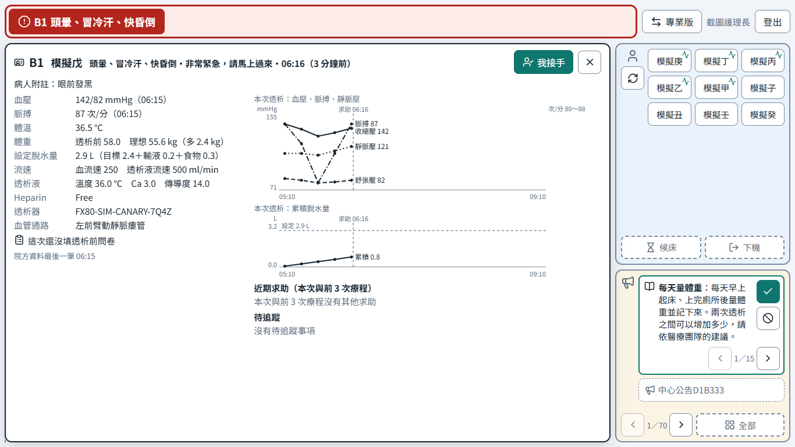

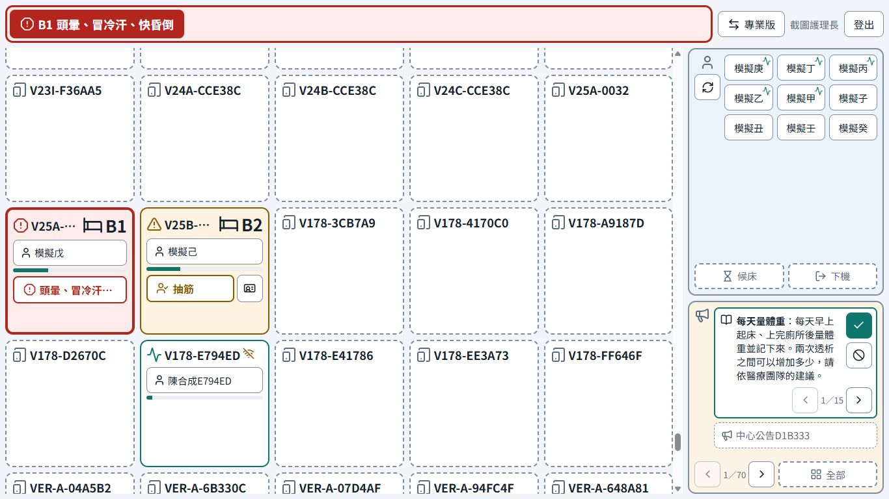

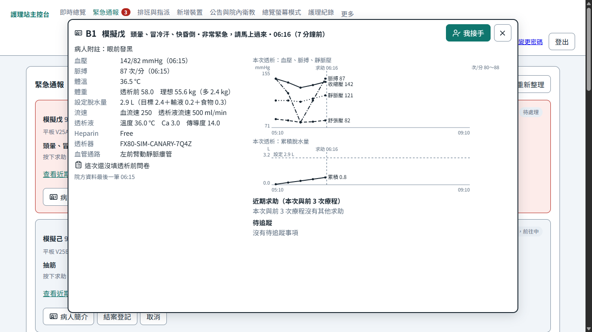

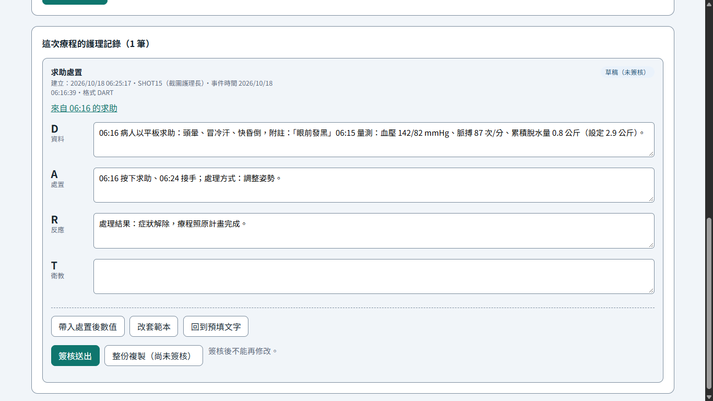

1920×1080 也看過一次（速覽同樣不捲動）：

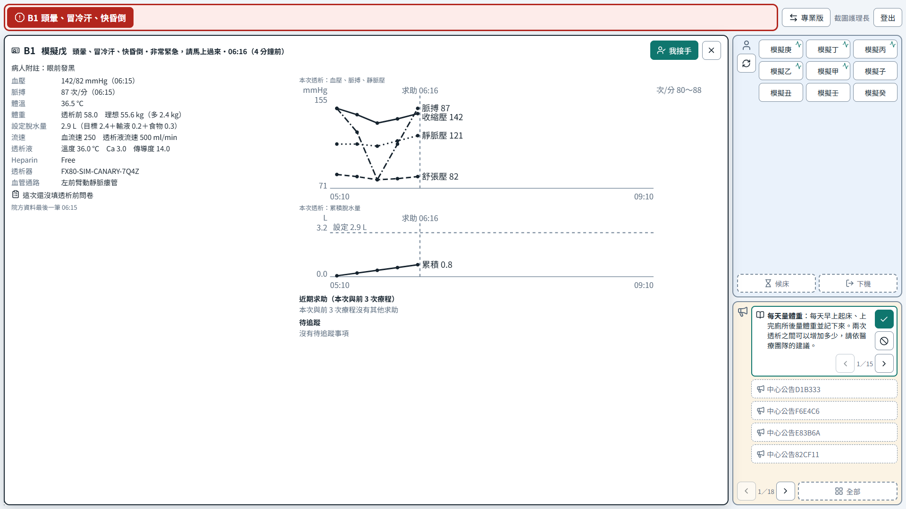

---

參考：[進度首頁](../index.md)
