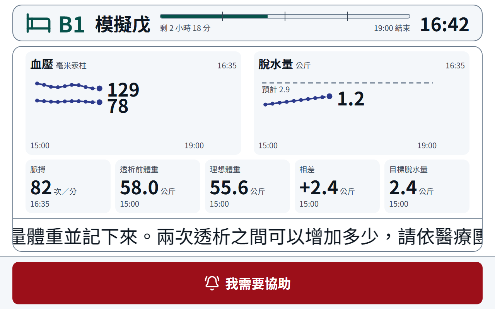
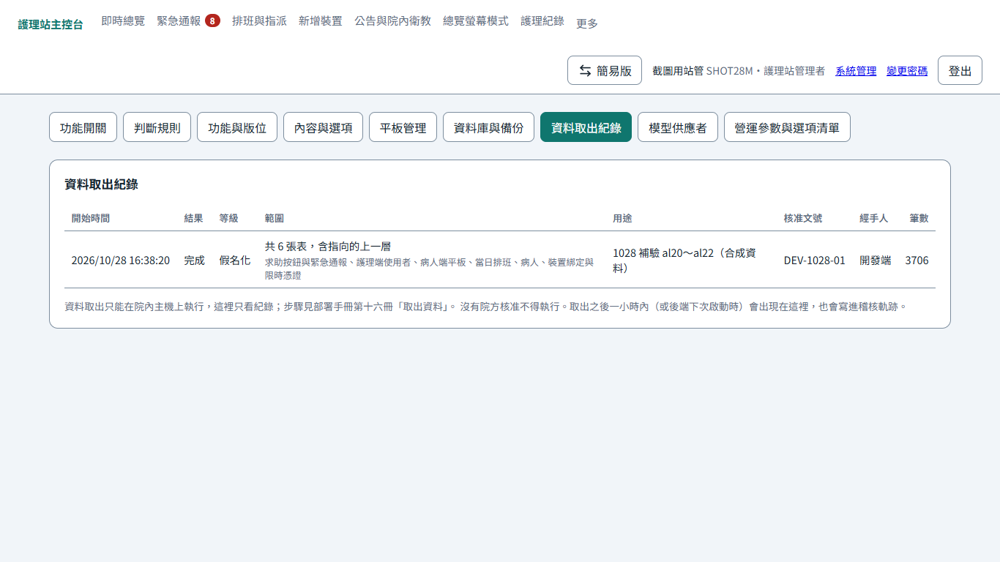
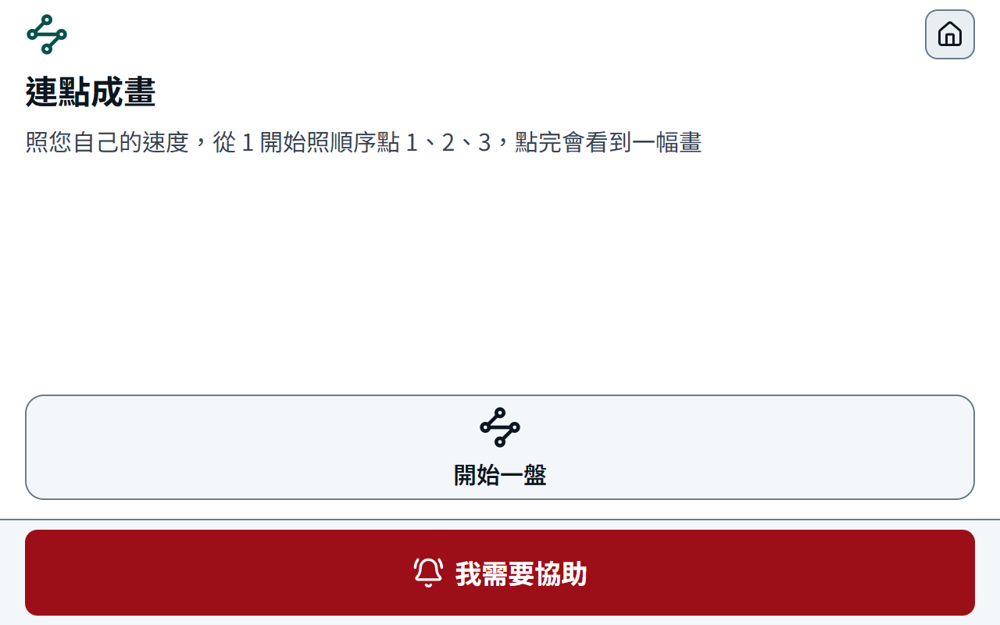
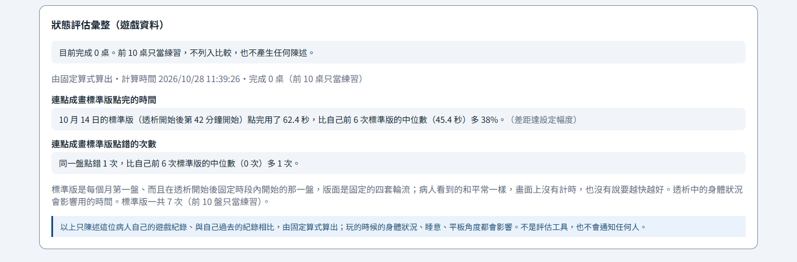
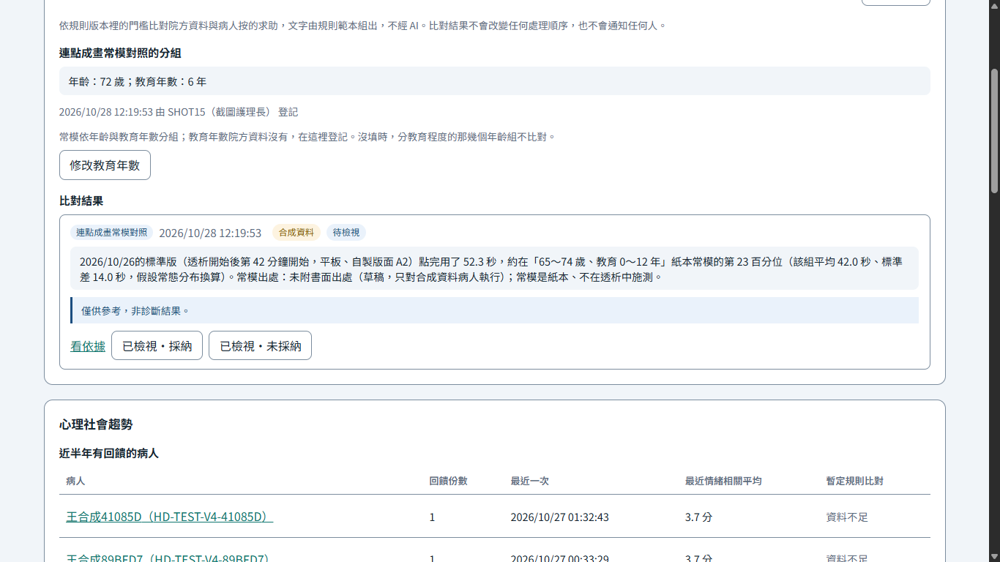
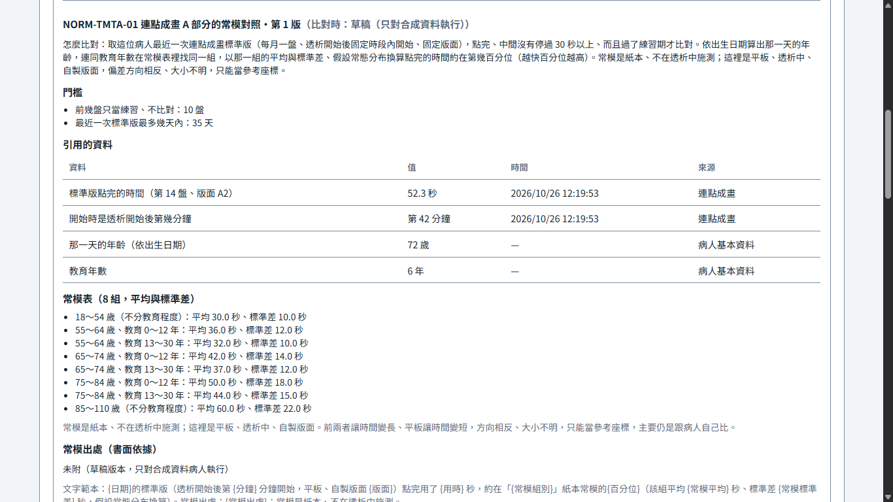

# 1028 週報 — 病人平板頂列一列、問卷醒著才出現、進度條寫出時間（迭代 27.1、27.2），蒐集資料的完整取出（迭代 28），第四款遊戲連點成畫、標準版與常模對照（迭代 29～31），緊急求助的語音與鏡頭排進需求

**期間**：2026-10-22 ～ 2026-10-28

**對應 commit**：`8b75309` 之後到本週文件的定版 commit；程式 `c0b8ce0`（迭代 27.1）、`332ab6c`（迭代 27.2）、`88ccece`（迭代 28）、`5c43fbc`、`95ede41`（迭代 29）、`cbf363d`（迭代 30）、`e8360cc`（迭代 31）、`47e0770`（1028 全量回歸補的步驟：`verify:iteration20:api` 開關數、資料取出紀錄不折行、兩張截圖）

**狀態**：完成（2026-10-27 起週中草稿，1028 補迭代 29～31 與全量回歸後定版）

---

## 摘要：本週進度

- **1027 迭代 27.1 完成**：病人平板頂列在 1280×800 任何組合都是一列，結案只寫「已處理」；心情問卷與衛教只在病人醒著時自動出現、最多 2 次、自己關掉不再跳；時點預設衛教 150、心情問卷 180 分鐘；`demo:patient` 午夜前後照常跑
- **1027 迭代 27.2 完成**：病人平板進度條底下左「剩 2 小時 19 分」、右「13:25 結束」，一小時一條刻度，與現在時間減得出來；過了結束時間只留結束時間；血壓圖寫「毫米汞柱」
- **1027 迭代 28 完成**：院內主機上一支只讀的取出指令，全部、某幾類、某幾張表三種範圍，完整與假名化兩級；沒有網路端點、沒有按鈕，照部署手冊第十六冊手動做；每張表歸類、每欄登記匯出分類，`check:export` 守住「全部」；取出紀錄進稽核軌跡與系統管理唯讀頁
- **1028 迭代 29 完成（連點成畫之一）**：第四款遊戲的遊戲模式——25 個圓依序點、點錯畫面不變、點完揭開一張記憶相簿的插畫；不計時、不會輸、沒有聲音與動畫；背景記下每一下，護理端只多「本月連點成畫 N 盤」；開關預設關，對真實病人收資料前要 Q-38 的答覆
- **1028 迭代 30 完成 A 部分（連點成畫之二）**：每月第一盤、透析開始後第 30～90 分鐘開始的那一盤自動換成固定的四套版面之一，病人看到的和平常一樣；護理端狀態評估彙整多兩句跟自己比的事實陳述（點完的時間、點錯幾次），附施測時點，前 10 盤只當練習；**圓、方交替的 B 部分沒做**，等 Q-40 第 2 題
- **1028 迭代 31 完成（連點成畫之三：常模對照，只對合成資料）**：護理端病人趨勢「判斷輔助」多一則「標準版點完用了 X 秒，約在某年齡、教育程度紙本常模的第 P 百分位」，附施測條件、常模出處與「僅供參考，非診斷結果。」；高風險功能，走規則引擎與書面確認閘門，真實病人等 Q-02 與 Q-40 第 1、3 題；系統裡的常模表是開發端編的示範數字、不是常模；教育年數由護理端登記
- **1028 全量回歸**（含 `:api`，77 支）74 支過：`verify:iteration13` 照舊紅、`13:api` 要 Docker 沒跑；`verify:iteration20:api` 抓到迭代 29 漏改的開關數，改後重跑過。27.1～29 收尾時被開發後端占住而沒做的也補了：模擬院方 API 那三支 `:api`、迭代 28 容器裡實跑與取出紀錄頁（`al17`～`al22`）、27.2 與 28 的開發機截圖
- 1025 使用者看過迭代 27 的病人平板，提出頂列換行、任務時點、午夜前後的鎖三件事，同日定案（27.1）；再提進度條沒有時間、血壓沒有單位（27.2）
- 1022～1026 規劃文件：暫用平板紀錄、緊急求助的語音說明與鏡頭、遊戲化之五（連點成畫）、蒐集資料的完整取出；SRS 83 → 85 條，排成迭代 28～31
- 文件架構重新規劃：衍生值交給 `docs:gen`、維護規則改成按任務分檔的 hd-docs skill；文件站加入匿名閱讀統計

## 完成內容

### 迭代 27.1：病人平板頂列一列、任務醒著才出現、午夜前後的鎖

說明：分析與量測在《[迭代 27.1 修正紀錄](../notes/iteration-27-1-fixes.md)》，實作與驗收現況在《[實作規格書](../requirements/implementation-spec.md)》4.27.1，手動測試在《[迭代 27.1 分冊](../testing/iteration-27-1.md)》（`ak19`～`ak36`）。

| 量測 | 值 |
|---|---|
| 頂列最壞組合（床號 A12、姓名 4 個字、1 個任務、遊戲、「護理師收到了」） | 一列，1280×800 實量餘 59px |
| 任務時點預設 | 衛教 150、心情問卷 180 分鐘，上限 225；舊資料庫由遷移改值並留稽核 |
| 自動驗收 | `verify:iteration27-1`（八步）、`verify:iteration27-1:api` 通過；`verify:iteration5`、`14`、`20` 隨需求改（實作規格書之一第二十二次） |
| 1028 補 | 結案訊息改了之後，`verify:iteration15:api`、`16:api`、`25:api`（要模擬院方 API）第一次跑，都過；開發機資料庫的遷移 1028 套上 |
| 實作文件 | 兩份進度報告、技術端的遷移數（26 → 27）、資料字典、測試主手冊與分冊、介面設計基準與 hd-uiux skill、技術棧說明檔頭、架構圖說明都已對到 27.1；部署手冊與外殼契約沒有影響（沒有新設定、外殼不動） |

### 迭代 27.2：病人平板進度條的剩餘時間與結束時間、血壓單位

說明：判斷與量測在《[迭代 27.2 修正紀錄](../notes/iteration-27-2-fixes.md)》，實作與驗收現況在《[實作規格書](../requirements/implementation-spec.md)》4.27.2，手動測試在《[迭代 27.2 分冊](../testing/iteration-27-2.md)》（`ak37`～`ak44`）。

| 量測 | 值 |
|---|---|
| 頂列最壞組合（床號 A12） | 一列，列高 95px 不變；進度條區塊 159px、剩餘那一句 131px 不截；結束時間收掉 |
| 平常（沒有狀態與任務） | 進度條區塊 560px，兩句都在，「13:25 結束」右端與進度條右端差 0px |
| 剩餘分鐘 | 09:25:40 開始、11:06:10 看是 139（原本進位成 140）；護理端即時總覽的同一個值跟著改，畫面上沒有用到 |
| 自動驗收 | `verify:iteration27-2`（六步）通過；`verify:iteration27-1` 的最窄 100px 隨需求改（實作規格書之一第二十三次） |
| 開發機截圖（1028，`demo:patient` 接真的後端） | 頂列一列；進度條底下「剩 2 小時 18 分」「19:00 結束」、三條一小時刻度；血壓寫「毫米汞柱」 |
| 實作文件 | 兩份進度報告、測試主手冊與分冊、介面設計基準與 hd-uiux skill、技術棧說明檔頭、架構圖說明都已對到 27.2；沒有遷移，資料字典不動；部署手冊與外殼契約沒有影響 |

### 迭代 28：蒐集資料的完整取出

說明：規劃在《[蒐集資料的完整取出](../notes/data-extraction-plan.md)》（與規劃不同的地方在它第 11 節），實作、開發端判斷與驗收現況在《[實作規格書](../requirements/implementation-spec.md)》4.28，院內的步驟在部署手冊[第十六冊](../deployment/16-data-export.md)，手動測試在《[迭代 28 分冊](../testing/iteration-28.md)》（`al1`～`al24`）。

| 量測 | 值 |
|---|---|
| 登記 | 98 張表歸進十二類、973 個欄位各一種匯出分類；資料字典 850 格與登記一致（`check:export`） |
| 開發機的資料庫副本 | 完整級 --all：97 張表、44853 筆、103 個檔案（那一份還沒有 `export_runs`，列為「這份資料沒有」） |
| 自動驗收 | `verify:iteration28`（八步）、`verify:iteration28:api`（八步，真的跑取出指令）通過；`check:container`、`check:egress` 跟著改（實作規格書之一第二十四次） |
| 回歸 | `verify:acceptance` 通過；2～27.2 共 47 支非 `:api` 回歸 46 支過，`verify:iteration13` 照舊紅（它把自己腳本裡的一行註解當成推論端點位址，與本迭代無關）；`check:all` 七支全綠（多了匯出分類那一支） |
| 1028 補：容器與取出紀錄 | 獨立 compose 專案實跑 `al17`～`al19`：預設 `up` 沒有 `data-export`；容器裡 `--list` 101 張表、`--category 病人自述` 假名化取出成功；路由表只有表頭、網路介面只有 `lo`、沒有 `/keys`。開發機走 `al20`～`al22`：取出紀錄多一列、表名中文、沒有按鈕；稽核一筆、五項都在；重新啟動筆數不變。測完容器、資料卷、映像檔都刪掉 |
| 開發機截圖（1028） | 系統管理「資料取出紀錄」第一次接真的後端截：結果、等級、核准文號、經手人折成兩行，改成不折行後重截 |
| 路由與稽核 | 221 → 222 條（`GET /ops/exports`，照啟動清單重數）、稽核動作 157 → 158；遷移多一個（`iteration28_export_runs`） |
| 實作文件 | 兩份進度報告、技術端表數與遷移數（97 → 98、27 → 28）、資料字典（每欄多「匯出分類」、第三十一章）、測試主手冊與分冊、路由表、部署手冊（新增第十六冊、第十五冊之一與之二補 `HD_EXPORT_DIR`、第十一冊、第十五冊交接表、總覽）、架構圖兩張各多一格；介面設計基準不動（只多一個系統管理分頁，照既有表格樣式）；技術棧說明與外殼契約沒有影響 |

### 迭代 29：連點成畫之一——遊戲模式

說明：設計在《[透析中的遊戲化之五](../notes/dialysis-gamification-benchmark.md)》3.1、6.1，實作、開發端判斷與驗收現況在《[實作規格書](../requirements/implementation-spec.md)》4.29，畫面規則在《[介面設計基準](../notes/uiux-design-baseline.md)》2.10，手動測試在《[迭代 29 分冊](../testing/iteration-29.md)》（`am1`～`am21`）。

| 量測 | 值 |
|---|---|
| 牌面 | 25 個圓（64px）在固定 1140×456px 的牌面上（15 × 6 格、每格 76px），1280×800 不捲動；離圓心 38px 內算點到 |
| 版面 | 相鄰兩號相距 2～4.5 格、總和 72～80 格、連線不穿過別的圓、左中右各至少 6 個；一千個種子都不用保底版面 |
| 開發機截圖（1028） | 遊戲選單、開始、點到一半、點完四個畫面都不捲動；點錯、點已點過、點空白三下之後牌面一字不差 |
| 自動驗收 | `verify:iteration29`（九步）、`verify:iteration29:api`（六步，全新資料庫）通過；`verify:iteration22`、`23` 隨新開關改（實作規格書之一第二十五次）；`verify:iteration20:api` 也寫死了開關數，當時漏改，1028 全量回歸補（第二十七次） |
| 回歸 | `verify:acceptance` 通過；`check:all` 七支全綠；2～29 共 40 支非 `:api` 回歸 39 支過，`verify:iteration13` 照舊紅（與本迭代無關） |
| 路由與資料表 | 222 → 224 條（照啟動清單重數）、98 → 100 張表、功能開關 23 → 24；稽核動作不變（158）；遷移多一個（`iteration29_connect_dots`） |
| 實作文件 | 實作規格書 4.0.5、4.18、4.29，之一第二十五次；資料字典第三十二章；資料庫使用規範 19.1；介面設計基準 2.10、3.10、4.1、4.6 與 hd-uiux skill；遊戲化之一第 4 節（開關 10）、之五第 7 節；兩份進度報告、測試主手冊與分冊、路由表；技術棧說明檔頭與「四款遊戲」那一列（沒有新的建材）；架構圖兩張都不必改（後端多一個模組、寫同一個資料庫，沒有新的元件與連線），說明補一段；部署手冊與外殼契約沒有影響（沒有新設定、外殼不動） |

### 迭代 30：連點成畫之二——標準模式與跟自己比（A 部分）

說明：設計在《[透析中的遊戲化之五](../notes/dialysis-gamification-benchmark.md)》3.2、4、6.2，實作、開發端判斷（九條，含 B 部分為什麼沒做、「前 10 次」怎麼讀）與驗收現況在《[實作規格書](../requirements/implementation-spec.md)》4.30，畫面規則在《[介面設計基準](../notes/uiux-design-baseline.md)》2.10、3.10，手動測試在《[迭代 30 分冊](../testing/iteration-30.md)》（`an1`～`an16`）。

| 量測 | 值 |
|---|---|
| 固定版面 | A1～A4 四套，距離總和 75.7～76.2 格（差不到 1 格）、都合 R1 的規則、1 號在四個不同象限；第 n 次標準版用第 (n − 1) mod 4 套 |
| 誰是標準版 | 伺服器先給這次療程的時窗與輪到哪一套，平板在時窗裡開始時帶代號；伺服器再核時窗、這個月、輪替三條，不合的照樣記、記成平常 |
| 開發機截圖（1028，`demo:patient`） | 病人端開始畫面多「照您自己的速度」，一行放得下、不捲動；護理端補了前 6 個月的合成標準版，兩句陳述與依據照算式出來 |
| 自動驗收 | `verify:iteration30`（八步）、`verify:iteration30:api`（五步，全新資料庫）通過；舊腳本都不必改 |
| 回歸 | `verify:acceptance` 通過；`check:all` 七支全綠；`verify:iteration5`、`22`、`29` 的後端驗收照樣通過；2～30 共 41 支非 `:api` 回歸 40 支過，`verify:iteration13` 照舊紅（與本迭代無關） |
| 路由與資料表 | 都沒有增減（224 條照啟動清單重數、100 張表、沒有遷移）；營運參數 41 → 46 |
| 實作文件 | 實作規格書 4.0.5、4.18、4.30；清冊 Q-40 現況；資料字典第三十二章與營運參數那一列；介面設計基準 2.10、3.10 與 hd-uiux skill；之五摘要與第 6.2、7 節；兩份進度報告、測試主手冊與分冊；技術棧說明檔頭（沒有新的建材）；架構圖不必改（沒有新元件、新的線）；部署手冊與外殼契約沒有影響（沒有新設定，營運參數啟動時自動補） |

### 迭代 31：連點成畫之三——常模對照

說明：設計在《[透析中的遊戲化之五](../notes/dialysis-gamification-benchmark.md)》4、5、6.3，實作、開發端判斷（十條，含常模表為什麼另開一張表、為什麼是示範值、教育年數放哪裡）與驗收現況在《[實作規格書](../requirements/implementation-spec.md)》4.31，畫面規則在《[介面設計基準](../notes/uiux-design-baseline.md)》3.6，手動測試在《[迭代 31 分冊](../testing/iteration-31.md)》（`ao1`～`ao16`）。

| 量測 | 值 |
|---|---|
| 怎麼算 | 最近一次標準版（35 天內、過了練習期、點完、沒停過 30 秒）；依出生日期算年齡、連同教育年數在常模表找同一組；以那一組的平均與標準差、常態分布換算百分位（越快越高，封頂第 1、99） |
| 閘門 | 書面確認沒登記：真實病人整位擋下；登記了但只有沒有出處的草稿：照樣不比對；查表當下再核一次出處與常模表（資料庫被直接改過也擋）；「連點成畫」關著時常模對照也不在 |
| 開發機截圖（1028，開發後端＋合成病人） | 病人趨勢「判斷輔助」：分組那一塊（72 歲、教育 6 年）與一則常模對照、免責那一條、沒有紅色；「看依據」：門檻、引用的資料四列、常模表 8 組、三種偏差、常模出處 |
| 自動驗收 | `verify:iteration31`（八步）、`verify:iteration31:api`（七步，全新資料庫）通過；`verify-iteration18.mjs` 的「六條、四項」改成「七條、五項」（實作規格書之一第二十六次） |
| 回歸 | `verify:acceptance`、`verify:iteration18:api`、`verify:iteration18-1:api` 通過；`check:all` 七支全綠；2～30 共 41 支非 `:api` 回歸 40 支過，`verify:iteration13` 照舊紅（與本迭代無關）；`verify:iteration18` 在整批跑時它連帶跑的 17.8 偶發失敗一次，兩支單獨重跑都過 |
| 路由與資料表 | 路由 224 → 226（照啟動清單重數）、資料表 100 → 101、稽核動作 158 → 159、功能開關 24 → 25、遷移多一支（只做加法） |
| 實作文件 | 實作規格書 4.0.5、4.18、3.6 那一段、4.31；清冊 Q-02、Q-40 現況；資料字典第二章 `patients`、第二十一章（新表與合法值）、第三十二章一句；介面設計基準 3.6 與 hd-uiux skill；之五摘要與第 6.3、7 節；之一第 4.1 節；上層文件 9.2 的例外；實作規格書之一第二十六次；兩份進度報告、測試主手冊、路由表與分冊；技術棧說明檔頭（沒有新的建材）；架構圖不必改（規則引擎已是實線、沒有新的線）；部署手冊與外殼契約沒有影響（沒有新設定，遷移照一般更新套用） |

### 1028 全量回歸

說明：27.1～29 收尾時開發後端被占住，只跑了非 `:api` 的回歸；迭代 31 做完後整批重跑一次。結果記在《[技術端進度報告](../reports/progress-technical.md)》第 10 節「最近一次執行」，各迭代補做的寫在實作規格書 4.27.1、4.27.2、4.28 的驗收現況。

| 量測 | 值 |
|---|---|
| 範圍 | 根目錄 `package.json` 的 `verify:*` 全部加 `check:all`，共 77 支；後端用乾淨的 `node dist/main.js`；`15:api`、`16:api`、`25:api` 另起模擬院方 API |
| 結果 | 74 支過；`verify:iteration13` 照舊紅（它把自己腳本裡的字當成推論端點位址）；`verify:iteration13:api` 要 Docker 的閘道，沒跑（迭代 17 之後沒有動閘道）；`verify:iteration20:api` 寫死九個遊戲化開關，改成十個後重跑過（實作規格書之一第二十七次） |
| 補做的手動項 | 迭代 28 分冊 `al17`～`al22`（容器裡實跑、取出紀錄頁與稽核）；`al23`、`al24` 要一位沒做過的人，仍待 |
| 順手修的 | 系統管理「資料取出紀錄」四欄不折行（`check:ui`、`check:ui:design`、`verify:iteration14`、`verify:iteration28` 重跑過） |
| 實作文件 | 實作規格書 4.27.1、4.27.2、4.28 的驗收現況與 4.29、4.31 各一句；之一第二十七次；技術端進度報告第 10 節（腳本清單、`check:all` 七支、測試項數 1593、最近一次執行）與第 6 節迭代 28；其餘文件沒有影響（沒有新路由、表、開關、設定） |

## 遇到的問題與處理

| # | 問題 | 處理方式 | 狀態 |
|---|---|---|---|
| 1 | 27.1 規劃時寫的最壞組合「餘約 10px」不對，27.2 重量差 40px | 實作時先把欄距改成 24px（27.2 的修正），照實作的元件重量餘 59px | 已解 |
| 2 | `verify:iteration17-3` 抓到《蒐集資料的完整取出》的「祕密」寫成禾字旁 | 改成示字旁的「祕密」；1027 又抓到這一列與實作規格書 4.27.1 描述這件事時把禾字旁的字原樣寫出來，改成用說的 | 已解 |
| 3 | 實作規格書 4.27.2 寫「不改既有驗收腳本」，但 `verify:iteration27-1` 驗的正是要改的「最窄 100px」 | 改成「有最窄的寬」，寬多少由 `verify:iteration27-2` 驗（實作規格書之一第二十三次） | 已解 |
| 4 | 迭代 28 規劃寫取出紀錄放匯出目錄，但部署規範 DEP-47 要 api 只掛備份與設定兩個主機目錄，api 讀不到 | 紀錄改寫到備份目錄的 `export-log.jsonl`；規範第 20 條、DEP-47、規劃第 11 節同步改 | 已解 |
| 5 | 開發機的資料實跑完整級時，登入憑證序號是唯一鍵，全部清成空字串撞唯一索引 | `data.sqlite` 裡那一欄的唯一索引一併拿掉，`manifest.json` 寫明；驗收腳本的合成資料改成兩筆會撞的 | 已解 |
| 6 | 開發機開著的開發後端鎖著資料庫，27.1、28（以及 29）的遷移套不上去；Docker 也沒開 | 1028 後端已經停了，三個遷移都套上；容器裡實跑列進分冊 `al17`～`al19`，仍待 Docker。1028 全量回歸查出鎖庫的是舊 session 留在背景的 `dev:api` watcher（改到後端原始碼就重新啟動、搶 3000 埠）；回歸改用 `node dist/main.js`，`al17`～`al19` 用 Docker 實跑過 | 已解（舊 watcher 要使用者手動關） |
| 7 | 迭代 29 截圖時，遊戲選單五顆排一列，一顆只剩約 233px，「老台灣記憶相簿」「我的衛教小本子」折成兩行、最後一個字落單 | 五顆時改排上三下二（不縮字），四顆以下照舊一列；分冊加 `am21` | 已解 |
| 8 | 迭代 30 的 B 部分要 Q-40 第 2 題（法務確認自製圓方版面不需任何人同意），還沒問 | 只做 A；repo 與鏡像是公開的，B 部分先不寫成程式，答「不需要」再開一次只做 B 的子迭代 | 待院方 |
| 9 | 資料字典 1027 寫「前 10 次只當練習看標準模式自己的次數」，照字面要將近一年才有第一句 | 實作時讀成這位病人的前 10 盤（不分模式），資料字典改掉；寫成實作規格書 4.30 開發端判斷 ⑤，使用者要推翻時改營運參數與那一條 | 待使用者確認 |
| 10 | 4.31 要「臨床端書面提供的常模表」，但現在沒有；開發端手上也沒有 Tombaugh 2004 可靠的原文數字 | 預設常模表用開發端編的整數，備註與陳述都寫明不是常模、沒有出處標不了生效；真實病人照樣擋下。正本等 Q-40 第 1 題 | 待院方 |
| 11 | 常模分教育程度，但院方資料沒有教育年數 | `patients` 加一欄，由護理端在病人趨勢「判斷輔助」那張卡登記並寫稽核（4.31 開發端判斷 ⑤）；病人告知時一併問（Q-40 第 3 題） | 待使用者確認 |
| 12 | 1028 全量回歸 `verify:iteration20:api` 不過：它寫死九個遊戲化開關，迭代 29 多了連點成畫；29 收尾只改了 22、23 的非後端版，`:api` 沒跑所以沒抓到 | 改成十個、重跑過（實作規格書之一第二十七次） | 已解 |
| 13 | 系統管理「資料取出紀錄」第一次接真的後端截圖，結果、等級、核准文號、經手人在窄欄位折成兩行、末字落單 | 這四欄不折行，錯誤訊息照常折行；重截 | 已解 |

## 待決事項

- [ ] 對真實病人收連點成畫的資料之前，醫師回覆要不要建本院參考值（清冊 Q-38）
- [ ] 法務回覆自製的圓方交替版面是否不需任何人同意（清冊 Q-40 第 2 題）；回覆之前迭代 30 只有 A 部分

緊急求助的錄音與鏡頭本週只規劃、沒寫程式，以下三題這次開會問醫師（題號與開發端建議見《[緊急求助的語音說明](../notes/emergency-voice-help.md)》第 9.2 節）：

- [ ] 原音轉寫完要不要刪（第 3 題）：逐字稿與語氣已定不刪；開發端建議轉寫完就刪、轉寫失敗的最多留 24 小時，不刪的話要定期限與存取權限；定案前只標記、不刪
- [ ] 院方建議配合鏡頭，原本希望看到什麼（第 12 題）：問清楚是「護理師出發前先看一眼」還是「事後看得到發作當下」；前者不做（派遣路徑不加步驟），後者唯一的候選是送出到護理師到床邊那一段錄影只存、醫師事後在紀錄頁看，依答覆再評估
- [ ] 平板有沒有支架、放在哪裡（第 13 題）：有沒有支架、裝在哪、每床一樣嗎、病人會不會拿下來；沒有支架的話鏡頭拍不到臉與上半身，介面設計基準的視距假設也要改

## 下週規劃

- ~~迭代 31（連點成畫之三：常模對照）照實作規格書 4.0.5 的順序；程式可以先做、只對合成資料~~ 1028 已完成（只對合成資料）
- 迭代 30 的 B 部分等 Q-40 第 2 題的答覆再開

---

參考：[進度首頁](../index.md)
