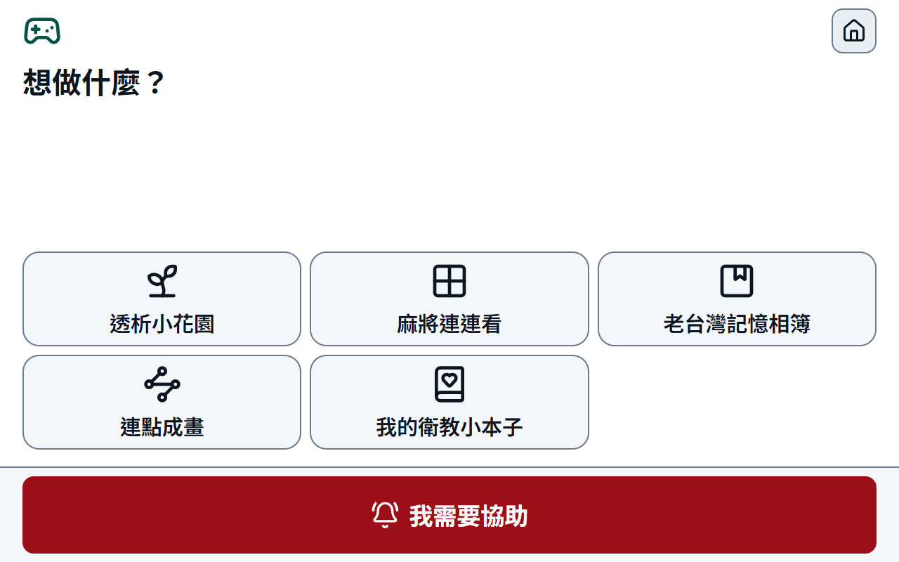
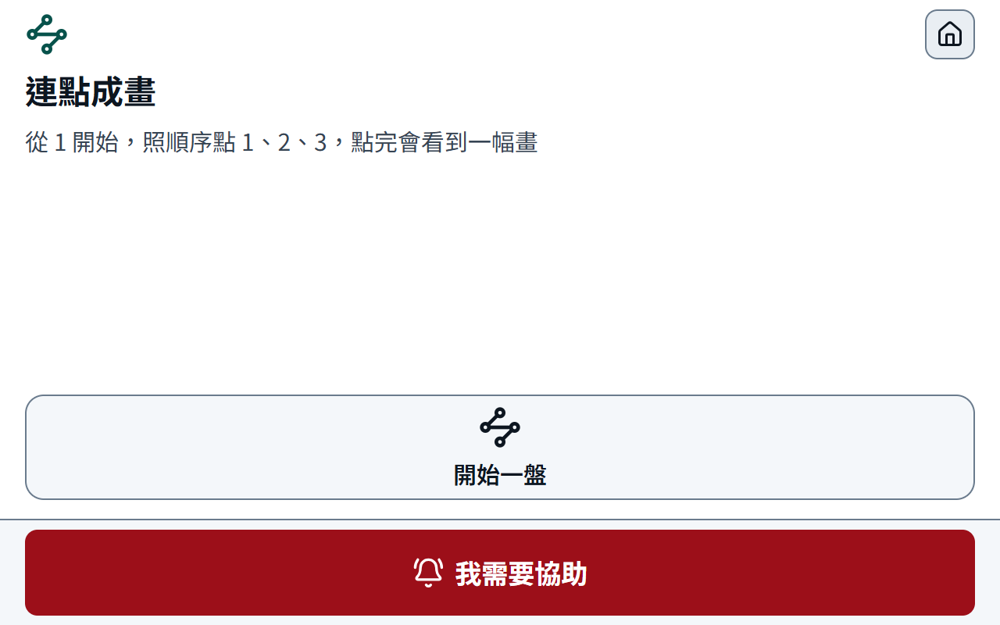
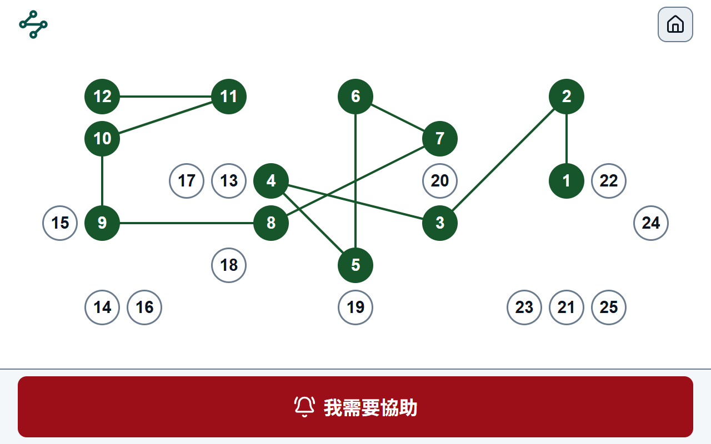
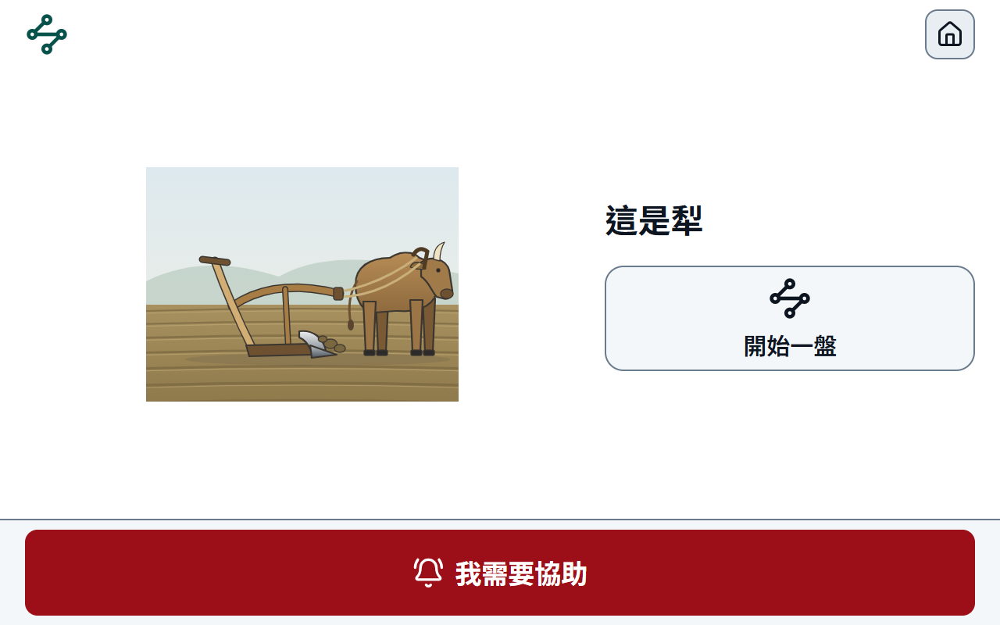

# 1028 週報 — 病人平板頂列一列、問卷醒著才出現、進度條寫出時間（迭代 27.1、27.2），蒐集資料的完整取出（迭代 28），第四款遊戲連點成畫（迭代 29），緊急求助的語音與鏡頭排進需求

**期間**：2026-10-22 ～ 2026-10-28

**對應 commit**：`c0b8ce0`（迭代 27.1）、`332ab6c`（迭代 27.2）、`88ccece`（迭代 28）、`5c43fbc`、`95ede41`（迭代 29）；定版前會再補

**狀態**：進行中（2026-10-27 週中草稿，1028 補迭代 29，定版時收尾）

---

## 摘要：本週進度

- **1027 迭代 27.1 完成**：病人平板頂列在 1280×800 任何組合都是一列，結案只寫「已處理」；心情問卷與衛教只在病人醒著時自動出現、最多 2 次、自己關掉不再跳；時點預設衛教 150、心情問卷 180 分鐘；`demo:patient` 午夜前後照常跑
- **1027 迭代 27.2 完成**：病人平板進度條底下左「剩 2 小時 19 分」、右「13:25 結束」，一小時一條刻度，與現在時間減得出來；過了結束時間只留結束時間；血壓圖寫「毫米汞柱」
- **1027 迭代 28 完成**：院內主機上一支只讀的取出指令，全部、某幾類、某幾張表三種範圍，完整與假名化兩級；沒有網路端點、沒有按鈕，照部署手冊第十六冊手動做；每張表歸類、每欄登記匯出分類，`check:export` 守住「全部」；取出紀錄進稽核軌跡與系統管理唯讀頁
- **1028 迭代 29 完成（連點成畫之一）**：第四款遊戲的遊戲模式——25 個圓依序點、點錯畫面不變、點完揭開一張記憶相簿的插畫；不計時、不會輸、沒有聲音與動畫；背景記下每一下，護理端只多「本月連點成畫 N 盤」；開關預設關，對真實病人收資料前要 Q-38 的答覆
- 1025 使用者看過迭代 27 的病人平板，提出頂列換行、任務時點、午夜前後的鎖三件事，同日定案（27.1）；再提進度條沒有時間、血壓沒有單位（27.2）
- 1022～1026 規劃文件：暫用平板紀錄、緊急求助的語音說明與鏡頭、遊戲化之五（連點成畫）、蒐集資料的完整取出；SRS 83 → 85 條，排成迭代 28～31
- 文件架構重新規劃：衍生值交給 `docs:gen`、維護規則改成按任務分檔的 hd-docs skill；文件站加入匿名閱讀統計

## 完成內容

### 迭代 27.1：病人平板頂列一列、任務醒著才出現、午夜前後的鎖

說明：分析與量測在《[迭代 27.1 修正紀錄](../notes/iteration-27-1-fixes.md)》，實作與驗收現況在《[實作規格書](../requirements/implementation-spec.md)》4.27.1，手動測試在《[迭代 27.1 分冊](../testing/iteration-27-1.md)》（`ak19`～`ak36`）。

| 量測 | 值 |
|---|---|
| 頂列最壞組合（床號 A12、姓名 4 個字、1 個任務、遊戲、「護理師收到了」） | 一列，1280×800 實量餘 59px |
| 任務時點預設 | 衛教 150、心情問卷 180 分鐘，上限 225；舊資料庫由遷移改值並留稽核 |
| 自動驗收 | `verify:iteration27-1`（八步）、`verify:iteration27-1:api` 通過；`verify:iteration5`、`14`、`20` 隨需求改（實作規格書之一第二十二次） |
| 實作文件 | 兩份進度報告、技術端的遷移數（26 → 27）、資料字典、測試主手冊與分冊、介面設計基準與 hd-uiux skill、技術棧說明檔頭、架構圖說明都已對到 27.1；部署手冊與外殼契約沒有影響（沒有新設定、外殼不動） |

### 迭代 27.2：病人平板進度條的剩餘時間與結束時間、血壓單位

說明：判斷與量測在《[迭代 27.2 修正紀錄](../notes/iteration-27-2-fixes.md)》，實作與驗收現況在《[實作規格書](../requirements/implementation-spec.md)》4.27.2，手動測試在《[迭代 27.2 分冊](../testing/iteration-27-2.md)》（`ak37`～`ak44`）。

| 量測 | 值 |
|---|---|
| 頂列最壞組合（床號 A12） | 一列，列高 95px 不變；進度條區塊 159px、剩餘那一句 131px 不截；結束時間收掉 |
| 平常（沒有狀態與任務） | 進度條區塊 560px，兩句都在，「13:25 結束」右端與進度條右端差 0px |
| 剩餘分鐘 | 09:25:40 開始、11:06:10 看是 139（原本進位成 140）；護理端即時總覽的同一個值跟著改，畫面上沒有用到 |
| 自動驗收 | `verify:iteration27-2`（六步）通過；`verify:iteration27-1` 的最窄 100px 隨需求改（實作規格書之一第二十三次） |
| 實作文件 | 兩份進度報告、測試主手冊與分冊、介面設計基準與 hd-uiux skill、技術棧說明檔頭、架構圖說明都已對到 27.2；沒有遷移，資料字典不動；部署手冊與外殼契約沒有影響 |

### 迭代 28：蒐集資料的完整取出

說明：規劃在《[蒐集資料的完整取出](../notes/data-extraction-plan.md)》（與規劃不同的地方在它第 11 節），實作、開發端判斷與驗收現況在《[實作規格書](../requirements/implementation-spec.md)》4.28，院內的步驟在部署手冊[第十六冊](../deployment/16-data-export.md)，手動測試在《[迭代 28 分冊](../testing/iteration-28.md)》（`al1`～`al24`）。

| 量測 | 值 |
|---|---|
| 登記 | 98 張表歸進十二類、973 個欄位各一種匯出分類；資料字典 850 格與登記一致（`check:export`） |
| 開發機的資料庫副本 | 完整級 --all：97 張表、44853 筆、103 個檔案（那一份還沒有 `export_runs`，列為「這份資料沒有」） |
| 自動驗收 | `verify:iteration28`（八步）、`verify:iteration28:api`（八步，真的跑取出指令）通過；`check:container`、`check:egress` 跟著改（實作規格書之一第二十四次） |
| 回歸 | `verify:acceptance` 通過；2～27.2 共 47 支非 `:api` 回歸 46 支過，`verify:iteration13` 照舊紅（它把自己腳本裡的一行註解當成推論端點位址，與本迭代無關）；`check:all` 七支全綠（多了匯出分類那一支） |
| 路由與稽核 | 221 → 222 條（`GET /ops/exports`，照啟動清單重數）、稽核動作 157 → 158；遷移多一個（`iteration28_export_runs`） |
| 實作文件 | 兩份進度報告、技術端表數與遷移數（97 → 98、27 → 28）、資料字典（每欄多「匯出分類」、第三十一章）、測試主手冊與分冊、路由表、部署手冊（新增第十六冊、第十五冊之一與之二補 `HD_EXPORT_DIR`、第十一冊、第十五冊交接表、總覽）、架構圖兩張各多一格；介面設計基準不動（只多一個系統管理分頁，照既有表格樣式）；技術棧說明與外殼契約沒有影響 |

### 迭代 29：連點成畫之一——遊戲模式

說明：設計在《[透析中的遊戲化之五](../notes/dialysis-gamification-benchmark.md)》3.1、6.1，實作、開發端判斷與驗收現況在《[實作規格書](../requirements/implementation-spec.md)》4.29，畫面規則在《[介面設計基準](../notes/uiux-design-baseline.md)》2.10，手動測試在《[迭代 29 分冊](../testing/iteration-29.md)》（`am1`～`am21`）。

| 量測 | 值 |
|---|---|
| 牌面 | 25 個圓（64px）在固定 1140×456px 的牌面上（15 × 6 格、每格 76px），1280×800 不捲動；離圓心 38px 內算點到 |
| 版面 | 相鄰兩號相距 2～4.5 格、總和 72～80 格、連線不穿過別的圓、左中右各至少 6 個；一千個種子都不用保底版面 |
| 開發機截圖（1028） | 遊戲選單、開始、點到一半、點完四個畫面都不捲動；點錯、點已點過、點空白三下之後牌面一字不差 |
| 自動驗收 | `verify:iteration29`（九步）、`verify:iteration29:api`（六步，全新資料庫）通過；`verify:iteration22`、`23` 隨新開關改（實作規格書之一第二十五次） |
| 回歸 | `verify:acceptance` 通過；`check:all` 七支全綠；2～29 共 40 支非 `:api` 回歸 39 支過，`verify:iteration13` 照舊紅（與本迭代無關） |
| 路由與資料表 | 222 → 224 條（照啟動清單重數）、98 → 100 張表、功能開關 23 → 24；稽核動作不變（158）；遷移多一個（`iteration29_connect_dots`） |
| 實作文件 | 實作規格書 4.0.5、4.18、4.29，之一第二十五次；資料字典第三十二章；資料庫使用規範 19.1；介面設計基準 2.10、3.10、4.1、4.6 與 hd-uiux skill；遊戲化之一第 4 節（開關 10）、之五第 7 節；兩份進度報告、測試主手冊與分冊、路由表；技術棧說明檔頭與「四款遊戲」那一列（沒有新的建材）；架構圖兩張都不必改（後端多一個模組、寫同一個資料庫，沒有新的元件與連線），說明補一段；部署手冊與外殼契約沒有影響（沒有新設定、外殼不動） |

## 遇到的問題與處理

| # | 問題 | 處理方式 | 狀態 |
|---|---|---|---|
| 1 | 27.1 規劃時寫的最壞組合「餘約 10px」不對，27.2 重量差 40px | 實作時先把欄距改成 24px（27.2 的修正），照實作的元件重量餘 59px | 已解 |
| 2 | `verify:iteration17-3` 抓到《蒐集資料的完整取出》的「祕密」寫成禾字旁 | 改成示字旁的「祕密」；1027 又抓到這一列與實作規格書 4.27.1 描述這件事時把禾字旁的字原樣寫出來，改成用說的 | 已解 |
| 3 | 實作規格書 4.27.2 寫「不改既有驗收腳本」，但 `verify:iteration27-1` 驗的正是要改的「最窄 100px」 | 改成「有最窄的寬」，寬多少由 `verify:iteration27-2` 驗（實作規格書之一第二十三次） | 已解 |
| 4 | 迭代 28 規劃寫取出紀錄放匯出目錄，但部署規範 DEP-47 要 api 只掛備份與設定兩個主機目錄，api 讀不到 | 紀錄改寫到備份目錄的 `export-log.jsonl`；規範第 20 條、DEP-47、規劃第 11 節同步改 | 已解 |
| 5 | 開發機的資料實跑完整級時，登入憑證序號是唯一鍵，全部清成空字串撞唯一索引 | `data.sqlite` 裡那一欄的唯一索引一併拿掉，`manifest.json` 寫明；驗收腳本的合成資料改成兩筆會撞的 | 已解 |
| 6 | 開發機開著的開發後端鎖著資料庫，27.1、28（以及 29）的遷移套不上去；Docker 也沒開 | 1028 後端已經停了，三個遷移都套上；容器裡實跑列進分冊 `al17`～`al19`，仍待 Docker | 遷移已解，容器待做 |
| 7 | 迭代 29 截圖時，遊戲選單五顆排一列，一顆只剩約 233px，「老台灣記憶相簿」「我的衛教小本子」折成兩行、最後一個字落單 | 五顆時改排上三下二（不縮字），四顆以下照舊一列；分冊加 `am21` | 已解 |

## 待決事項

- [ ] 護理長看《迭代 27.1 修正紀錄》3.2「四小時裡病人在做什麼」那張表與新時點
- [ ] 平板上實測睡著不跳、碰了才跳（迭代 27.1 分冊 `ak25`～`ak28`）
- [ ] 下次進院請長者在床上看進度條底下那一行 20px 的字（迭代 27.2 分冊 `ak37`）
- [ ] 一位沒做過的人照部署手冊第十六冊、不用 AI，做一次部分取出與第二條路（迭代 28 分冊 `al23`、`al24`）
- [ ] 院方回覆資料取出的核准流程與取出之後的去處（清冊 Q-39）；之前只對合成資料做
- [ ] 第三次進院換版時，1001 那一份 `.env` 要補 `HD_EXPORT_DIR`（第十五冊之一第 6 節）
- [ ] 平板上實際點一盤連點成畫：點錯畫面不變、斷線照樣能點、放下超過 30 秒再點（迭代 29 分冊 `am7`～`am16`）
- [ ] 請長者看「連點成畫」的名字、圖示與揭開的圖（迭代 29 分冊 `am19`、`am20`；之五第 8 節第 1、2 題）
- [ ] 對真實病人收連點成畫的資料之前，醫師回覆要不要建本院參考值（清冊 Q-38）

## 下週規劃

- 迭代 30、31（連點成畫之二、之三）照實作規格書 4.0.5 的順序；30 的 B 部分要先有 Q-40 第 2 題的答覆

---

參考：[進度首頁](../index.md)
